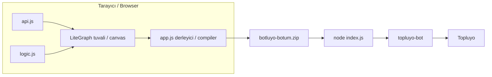

# Botluyo v2

[Türkçe](#türkçe) · [English](#english) · [API kataloğu / API catalog](#api-kataloğu--api-catalog)

<p>
  
  
  
  
  
  
  
</p>

Kod yazmadan [Topluyo](https://topluyo.com) botu kurmak için blueprint (düğüm ve tel) editörü. Canlı sürüm: [rid1-yilmaz.github.io/botluyo-v2](https://rid1-yilmaz.github.io/botluyo-v2/). Tuvaldeki düğümler Node.js kaynağına derlenir, ZIP iner, bot [`topluyo-bot`](https://github.com/topluyo/TopluyoBOTJS) ile Topluyo'ya bağlanır.

A blueprint editor for building a [Topluyo](https://topluyo.com) bot without writing the script by hand. Live app: [rid1-yilmaz.github.io/botluyo-v2](https://rid1-yilmaz.github.io/botluyo-v2/). Nodes on the canvas compile to Node.js, a ZIP downloads, and the bot connects through [`topluyo-bot`](https://github.com/topluyo/TopluyoBOTJS).

Bu depo v2'dir. Önceki Blockly editörü: [RID1-YILMAZ/Botluyo](https://github.com/RID1-YILMAZ/Botluyo), canlı adresi [rid1-yilmaz.github.io/Botluyo](https://rid1-yilmaz.github.io/Botluyo/). Editör kurulum istemez. Sayfa GitHub Pages üzerindedir.

This repository is v2. The previous Blockly editor is [RID1-YILMAZ/Botluyo](https://github.com/RID1-YILMAZ/Botluyo), live at [rid1-yilmaz.github.io/Botluyo](https://rid1-yilmaz.github.io/Botluyo/). The editor needs no install. The page is on GitHub Pages.

Editör botu tarayıcıda çalıştırmaz. Soket açmaz, token'ı hiçbir yere göndermez, `api.js` listesini Topluyo'dan kendiliğinden yenilemez.

The editor never runs the bot in the browser. It opens no socket, uploads no token, and does not refresh `api.js` from Topluyo.



---

## Türkçe

### İçindekiler

- [Ne işe yarar](#ne-işe-yarar)
- [v1 ile fark](#v1-ile-fark)
- [Hızlı başlangıç](#hızlı-başlangıç)
- [Arayüz](#arayüz)
- [Tuvali kullanmak](#tuvali-kullanmak)
- [İki tür tel](#iki-tür-tel)
- [Derleyici](#derleyici)
- [Menü ve yükleme sırası](#menü-ve-yükleme-sırası)
- [Olay düğümleri](#olay-düğümleri)
- [Veri düğümleri](#veri-düğümleri)
- [API düğümleri](#api-düğümleri)
- [Mantık ve akış](#mantık-ve-akış)
- [Metin ve matematik](#metin-ve-matematik)
- [Değişkenler](#değişkenler)
- [Yardımcılar](#yardımcılar)
- [Üretilen kod](#üretilen-kod)
- [Örnekler](#örnekler)
- [ZIP](#zip)
- [Token ve güvenlik](#token-ve-güvenlik)
- [Kayıt](#kayıt)
- [API tablosunu güncellemek](#api-tablosunu-güncellemek)
- [Sınırlar](#sınırlar)
- [Sorun giderme](#sorun-giderme)
- [Dosyalar](#dosyalar)
- [Lisans ve bağlantılar](#lisans-ve-bağlantılar)
- [API kataloğu](#api-kataloğu--api-catalog)

### Ne işe yarar

Botluyo v2, [LiteGraph](https://github.com/jagenjo/litegraph.js) tuvali üstüne kurulu bir Topluyo bot IDE'sidir. Sağ tıkla düğüm eklersin, pinleri telle bağlarsın, **💻 Kodu Gör** üretilen `index.js` metnini açar, **📦 ZIP İndir** çalıştırılabilir bir Node projesi indirir.

Şunları yapar:

- Mesaj, mention, form, özel mesaj, Turbo transferi ve gruba katılmayı dinler.
- Bağlanınca bir kez çalışan bir akış, ya da saniye cinsinden `setInterval` zamanlayıcısı kurar.
- Olay pinlerinden kullanıcı, kanal, mesaj, grup, gönderi ve Turbo alanlarını okur.
- Form gövdesindeki adlı bir alanı okur.
- `api.js` içindeki **21 grup, 132** [Topluyo API](https://topluyo.com/!api) ucunu ayrı birer düğüm yapar. Her çağrının yanıtı kendi `res_<düğümId>` değişkenindedir. v1'deki tek `_son` kovası yoktur; iki çağrı birbirinin yanıtını silmez.
- Yanıt nesnesinin seçtiğin alanını okur.
- Eğer / değilse, karşılaştırma, liste döngüsü, bekleme, dört işlem, metin birleştirme, kelime ayırma, metin arama, değişken ata / oku ve `console.log` üretir.
- Tuvali bu tarayıcıda, bu origin'de otomatik saklar.
- ZIP'e `index.js`, `package.json`, `.token.json` ve `.gitignore` koyar.

Şunları yapmaz:

- Botu tarayıcıda çalıştırmaz. Test için ZIP'i Node.js 18+ ile aç.
- Token'ı sunucuya, `localStorage`'a veya üretilen kaynağın içine yazmaz. ZIP'teki `.token.json` her zaman yer tutucudur. Token'ı sen dosyaya yazarsın, ya da `TOKEN` ortam değişkeni verirsin.
- Çoklu dosya projesi kurmaz. Çıktı tek `index.js` dosyasıdır.
- Gruptan ayrılma ve gruptan atılma olaylarını dinlemez. Atmak için API düğümü **Üyeyi gruptan at** (`/!api/member/kick`) vardır; bu bir dinleyici değildir.
- Turbo `transfer_id` pinini çıkarmaz.
- Ve / veya / değil, `while`, tekrar-N, kır, devam, rastgele sayı, mod, metin uzunluğu, `startsWith` düğümü yoktur. Bunlar v1'de Blockly kataloğundaydı.
- Hatalı teli tuvalde uyarı olarak işaretlemez. Ulaşılmayan düğüm sessizce koda girmez.
- Üretilen dinleyicinin gövdesine `try/catch` koymaz. `auth_problem` ve `error` dinleyicisi de koymaz. Bunlar v1 şablonundaydı.

### v1 ile fark

| | [Botluyo (v1)](https://github.com/RID1-YILMAZ/Botluyo) | Botluyo v2 |
|---|---|---|
| Editör | Blockly 10.4.3, iç içe blok | LiteGraph, düğüm ve tel |
| Canlı sayfa | [rid1-yilmaz.github.io/Botluyo](https://rid1-yilmaz.github.io/Botluyo/) | [rid1-yilmaz.github.io/botluyo-v2](https://rid1-yilmaz.github.io/botluyo-v2/) |
| Dosyalar | `index.html`, `style.css`, `app.js`, `api.js` | `index.html`, `app.js`, `logic.js`, `api.js`, `LICENSE` |
| Çıktı | `index.js` + isteğe bağlı modüller | Yalnız `index.js` |
| ZIP adı | `topluyo-bot.zip` | `botluyo-botum.zip` |
| ZIP içeriği | kaynak, `package.json`, `.token.json`, `.gitignore`, kısa `README.md` | kaynak, `package.json`, `.token.json`, `.gitignore`. İç README yok |
| Token | **Tokenli indir** ZIP'e yazar | Her zaman `"BURAYA_TOKENINIZI_YAZIN"`. Çalışırken `process.env.TOKEN` dosyadan önce okunur |
| Kayıt anahtarı | `localStorage` `botluyo-v2` | `localStorage` `botluyo_v2_save`. Eski tuval açılmaz |
| Kayıt sıklığı | Değişiklikten \~200 ms sonra | 5 saniyede bir, ve **Kaydet**'e basınca |
| API yanıtı | Dosya başına tek `_son`. Yeni çağrı eskisini ezer | Çağrı başına `let res_<id>` |
| Boş API yuvası | Gövdeye yazılmaz | Yazılır. Metin `''`, sayı `0` olur |
| Sayı alanı | Düz sayı literali tırnaksız basılır | Yalnız **Sayı** düğümü sayı literali basar. **Metin** düğümü her zaman tırnaklıdır. `#` tırnak soymaz |
| Hata | Her şapkanın gövdesi `try/catch`. Şablon `auth_problem` ve `error` dinler | Yok. Reddedilen `await` o dinleyiciyi keser |
| Olaylar | v2'dekiler + gruptan ayrılma, atılma, Turbo `transfer_id` | 6 mesaj eylemi + bağlanma + zamanlayıcı |
| Mantık | Blockly: ve/veya/değil, while, tekrarla, mod, rastgele | Eğer, karşılaştırma, For-Each |
| Lisans | Depoda lisans dosyası yoktu | MIT, Copyright (c) 2026 Rıdvan Yılmaz |

v1'in anlatımı (olayların `data.action` değerleri, token'ın cihaz anahtarı olması, rumuzun `bot` ile başlayıp bitmesi, Park'ın kalıcı bellek olması) bu sürüm için de geçerlidir. Kütüphane aynıdır: [topluyo-bot](https://github.com/topluyo/TopluyoBOTJS).

### Hızlı başlangıç

Editör hazır: [rid1-yilmaz.github.io/botluyo-v2](https://rid1-yilmaz.github.io/botluyo-v2/)

Kurulum yok. Depoyu indirme, sunucu açma. Sayfa GitHub Pages'tedir. LiteGraph, JSZip ve FileSaver sayfayla birlikte CDN'den gelir. İnternet yeter.

İlk açılışta tuval boşsa sol tarafta **Mesaj Gelince** düğümü durur. Kayıt varsa o yüklenir, başlangıç düğümü konmaz.

1. Tuvalde sağ tık → **Add Node**.
2. Bir olay düğümünün **Çalıştır** pininden iş düğümünün **Çalıştır** pinine tel çek. Tel yoksa düğüm koda girmez.
3. Değer pinlerini bağla. API alanına sabit yazmak için önce **Metin** veya **Sayı** düğümü koy; API düğümünün üstünde yazı kutusu yoktur.
4. **💻 Kodu Gör** ile sağ altta üretilen kaynağı oku.
5. **📦 ZIP İndir**. Dosya adı her zaman `botluyo-botum.zip`.
6. Çalıştır:

```bash
unzip botluyo-botum.zip -d botum
cd botum
npm install
```

`.token.json` bir JSON **metnidir**, nesne değildir. Dosyayı şöyle bırak:

```json
"BURAYA_TOKENINIZI_YAZIN"
```

Tırnaklar durur. İçine Topluyo **Cihazlarım** bölümündeki cihaz anahtarını yaz. Rumuz `bot` ile **başlamalı ya da bitmelidir** (`botMuzo`, `MuzoBot`). Bu kural editörde değil, `topluyo-bot` / hesap tarafındadır.

```bash
npm start
```

`package.json` içindeki `start`, `node index.js` çalıştırır. Aynı şey:

```bash
TOKEN="buraya" npm start
```

`process.env.TOKEN` doluysa `.token.json` okunmaz.

Boş bir akış bile şu iskeleti indirir. Bağlanınca konsola `Bot bağlandı! ✅` yazar. Bu satır her ZIP'te vardır; sen **Bot Bağlanınca** eklemesen de.

```js
// Botluyo Blueprint ile otomatik oluşturuldu
const TopluyoBOT = require('topluyo-bot');
const bot = TopluyoBOT(process.env.TOKEN || require('./.token.json'));
bot._hazir = false;

bot.on('connected', () => { bot._hazir = true; console.log('Bot bağlandı! ✅'); });
```

### Arayüz

Sayfa tek tuvaldir. Ayrı bir CSS dosyası yoktur. Stil `index.html` içindedir. 900 piksel kırılımı yoktur; dar ekranda araç çubuğu logonun üstüne binebilir. Amaç masaüstü tarayıcıdır.

| Bölge | Ne |
|---|---|
| Sol üst | `Botluyo Blueprint v2`. Tıklanamaz (`pointer-events: none`) |
| Sağ üst | **💾 Kaydet**, **🗑️ Temizle**, **💻 Kodu Gör**, **📦 ZIP İndir** |
| Tuval | `#blueprint-canvas`, tüm pencere. Arka plan `#1e1e1e` |
| Sağ alt | `#code-output`. Varsayılan gizli. Açılınca genişlik %40, yükseklik %40, siyah zemin, yeşil monospaced metin. Tüm programdır, tek düğüm değil |

| Düğme | Yapar |
|---|---|
| **💾 Kaydet** | `graph.serialize()` sonucunu `localStorage` anahtarı `botluyo_v2_save` altına yazar. Sonra `Proje kaydedildi!` penceresi |
| **🗑️ Temizle** | `Tüm tuvali temizle?` diye sorar. Evet ise `graph.clear()` ve anahtarı siler |
| **💻 Kodu Gör** | Paneli açar veya kapatır. Her basışta `generateBotCode()` yeniden çalışır |
| **📦 ZIP İndir** | O anki tuvalden ZIP üretir. Tuvalin kendisini ZIP'e koymaz |

Kaydet'e basmasan da 5 saniyede bir aynı anahtar yazılır.

### Tuvali kullanmak

Kütüphane [litegraph.js](https://tamats.com/projects/litegraph/build/litegraph.js) sürüm sabitlemesi olmadan `tamats.com` adresinden gelir. CSS eşi `litegraph.css` aynı hosttadır.

| Hareket | Sonuç |
|---|---|
| Boş yerde sağ tık | Menü. **Add Node** alt menüsü düğüm türlerini klasörler |
| Düğümün başlığından sürükle | Taşı |
| Boş tuvali sürükle | Kaydır |
| Tekerlek | Yakınlaştır / uzaklaştır |
| Çıkış pininden giriş pinine sürükle | Tel |
| Düğüme tıkla, `Delete` veya `Backspace` | Seçili düğümü sil. Odak bir yazı kutusundaysa silmez |
| `Ctrl/Cmd+A` | Hepsini seç |
| `Ctrl/Cmd+C`, `Ctrl/Cmd+V` | Kopyala, yapıştır |
| `Esc` | Açık LiteGraph panelini kapat |
| Düğümde sağ tık | Başlık, renk, daralt, sabitle, özellikler, silme ile ilgili LiteGraph menüsü |

Bir yürütme pininden çıkan birden fazla tel varsa derleyici **yalnızca ilk teli** izler. İkinci tel tuvalde durur, koda girmez.

Yürütme tellerinde döngü kurma. Derleyici ziyaret ettiği düğümü hatırlamaz. **Kodu Gör** veya **ZIP İndir** sekmesi kilitlenebilir.

`graph.start()` tuvalin kendi çizim döngüsünü başlatır. Botluyo düğümlerinde `onExecute` yoktur. Tuval "oynuyor" gibi görünse de tarayıcı Topluyo'ya bağlanmaz.

### İki tür tel

Bu, v1'deki "şapkanın içine tak" modelinin karşılığıdır. Yerleşim önemli değildir. Önemli olan teldir.

**Yürütme telleri** cümle sırasını belirler. Pin adları: **Çalıştır**, **Sonraki**, **Doğru (True)**, **Yanlış (False)**, **Döngü**, **Tamamlandı**. Bunlar LiteGraph'te `ACTION` (giriş) ve `EVENT` (çıkış) türündedir.

**Veri telleri** ifade üretir. Tek başlarına satır olmazlar. Bir yürütme düğümünün yuvasına girerler ve orada iç içe JavaScript ifadesi olurlar.

Ulaşılmayan düğüm yok sayılır. Veri düğümü, ancak bir yürütme zincirinin içinden okunursa koda girer. Zincir yalnızca olay düğümlerinin **Çalıştır** çıkışından başlar.

Kötü ve iyi sıra:

```text
İYİ
Mesaj Gelince.Çalıştır → Değişken Ata → Sonraki → Konsola Yaz
                              değer ↑              veri ↑
                         Mesaj metni          Değişken Oku

KÖTÜ
Mesaj Gelince.Çalıştır → Konsola Yaz
ve Değişken Ata bu telin üzerinde değil.
Konsola Yaz, atamadan önce çalışır ya da hiç yazılmaz.
```

Veri teli sıra kurmaz. `let` satırı, düğüm yürütme yürüyüşünde ziyaret edilince yazılır. Yanıtı, onu üreten API düğümünden **sonra** oku.

### Derleyici

`generateBotCode()` tuvali `graph.serialize()` ile dondurur. Düğümler `nodes`, teller `links` dizisindedir. Tel kaydı `[telId, kaynakDüğüm, kaynakPin, hedefDüğüm, hedefPin, tür]` şeklindedir.

Yürüyüş:

1. İskeleti yaz. Hazır bayrağı, `TOKEN`, kütüphane, hazır `connected` dinleyicisi.
2. Türü `Botluyo_Events/` ile başlayan her düğüm için bir dinleyici aç. Sıra, tuvaldeki sol-sağ değil, düğümün eklenme sırasıdır.
3. O düğümün 0. çıkışındaki ilk telin hedefini üret.
4. Düğüm türüne göre satır bas, sonra devam pinindeki ilk teli izle.
5. Değer gerekince veri telini kaynağa kadar yürü ve ifadeyi satırın içine göm.
6. Hiçbir yürütme zincirinden ulaşılmayan düğümü at.

Özel dönüşler:

- **Eğer** hem **Doğru** hem **Yanlış** kolunu basar ve **geri döner**. Eğer'den sonra üçüncü bir "devam" pini yoktur. İki koldan da aynı düğüme tel çekersen o düğüm **iki kez** basılır, bir kez her kolun içinde.
- **For-Each** gövdeyi döngünün içine, **Tamamlandı** hedefini döngünün **dışına** basar ve geri döner.

Boş veri teli `resolveData` içinde `"null"` metnini döndürür. Bu metin JavaScript'te dolu bir string olduğu için bazı `|| "yedek"` ifadeleri devreye girmez:

| Durum | Üretilen |
|---|---|
| Bağsız karşılaştırma tarafı | `null` |
| Bağsız Eğer koşulu | `if (null)` — koşul hep yanlış, yalnız **Yanlış** kolu işe yarar |
| Bağsız Bekle saniyesi | `(null) * 1000`, yani 0 ms. Varsayılan 1 saniye **değildir** |
| Bağsız Includes / Birleştir tarafı | `String(null)`, yani `"null"` metni |
| Bağsız For-Each listesi | `null \|\| []`, yani boş döngü |
| Bağsız sayı yuvası (API) | `0` |
| Bağsız metin yuvası (API) | `''` |
| Bağsız Konsola Yaz | `console.log(null)` |
| Bağsız Değişken Ata | `vars['ad'] = null` |

**Metin** düğümü değeri tek tırnakla, kaçışsız basar: `'${değer}'`. Değerin içinde `'`, satır sonu veya `\` varsa üretilen dosya sözdizimi bozulur. **Değişken adı** ve **nesne alan adı** da kaçışsız gömülür. Tırnak koyma.

Karşılaştırma işleci düğümün kutusundan olduğu gibi gömülür. Kutudaki altı değer: `==`, `!=`, `>`, `<`, `>=`, `<=`. Bunlar JavaScript işleçleridir. `==` tür zorlar (`1 == '1'` doğrudur). `===` yoktur.

### Menü ve yükleme sırası

`index.html` sırası şöyledir:

1. `litegraph.js` — kütüphane kendi örnek düğümlerini de kaydeder
2. `jszip.min.js`, `FileSaver.min.js`
3. `api.js` — `API_LIST` metnini kurar, düğüm kaydetmez
4. `logic.js` — mantık, metin, matematik, değişken, döngü, bekle, konsol, bağlanma ve zamanlayıcıyı kaydeder
5. `app.js` — **ilk satır `LiteGraph.clearRegisteredTypes()`**

`clearRegisteredTypes` kayıt defterini boşaltır (`registered_node_types = {}`). Amaç LiteGraph'in örnek düğümlerini menüden silmektir. Çağrı `logic.js`'ten **sonra** olduğu için o dosyadaki kayıtlar da silinir. Ardından `app.js` yalnızca şunları yeniden kaydeder:

- `Botluyo_Events/` altındaki 6 mesaj olayı
- `Botluyo_Data/Metin`, `Sayi`, `Nesne_Verisi_Al`, `Form_Alani`
- `api.js` satırlarından gelen 132 API düğümü

Bu yüzden bugünkü menüde **Eğer, Karşılaştırma, Metin İçeriyor mu, Değişken Ata / Oku, Metin Birleştir, Kelime Al, Dört İşlem, For-Each, Bekle, Konsola Yaz, Bot Bağlanınca, Zamanlayıcı** görünmez. Derleyici bu türlerin hepsini bilir. Kayıtta böyle bir düğüm olsa bile tür menüde yokken tuval onu yeniden kuramayabilir.

Düzeltmek için temizliği `logic.js`'ten önce yap ve `app.js` başındaki satırı kaldır. Örneğin `litegraph.js`'ten hemen sonra:

```html
<script src="https://tamats.com/projects/litegraph/build/litegraph.js"></script>
<script>LiteGraph.clearRegisteredTypes();</script>
<script src="api.js"></script>
<script src="logic.js"></script>
<script src="app.js"></script>
```

`app.js` içindeki `LiteGraph.clearRegisteredTypes();` satırı durursa `logic.js` yine silinir. Yalnızca o satırı silmek de olmaz: LiteGraph'in kendi yüzlerce örnek düğümü menüye döner ve derleyici onları yok sayar.

Aşağıdaki mantık, metin, değişken, döngü ve yardımcı bölümleri derleyicinin ürettiği koda göredir. Menüde görmüyorsan önce bu sırayı düzelt.

### Olay düğümleri

Olay düğümünün giriş pini yoktur. **Çalıştır** çıkışı akışı başlatır. Yanındaki çıkışlar salt okunur veridir.

Mesaj türleri tek soket dinleyicisine iner ve `data.action` ile süzülür. Alan adları [topluyo-bot](https://github.com/topluyo/TopluyoBOTJS) olay tablosundandır. Gövde rengi koyu kırmızı (`#701010` / `#500a0a`).

| Menü yolu | Başlık | `data.action` | Çıkış pinleri ve ürettikleri |
|---|---|---|---|
| `Botluyo_Events/Mesaj_Gelince` | Mesaj Gelince | `post/add` | Kullanıcı ID → `data.user_id`, Kanal ID → `data.channel_id`, Mesaj Metni → `data.message` |
| `Botluyo_Events/Mention_Gelince` | Mention Gelince | `post/mention` | `data.user_id`, `data.channel_id`, `data.message` |
| `Botluyo_Events/Ozel_Mesaj_Gelince` | Özel Mesaj Gelince | `message/send` | `data.user_id`, `data.message` |
| `Botluyo_Events/Turbo_Gelince` | Turbo Gelince | `turbo/transfer` | `data.user_id`, `data.message.quantity`, `data.message.message` |
| `Botluyo_Events/Gruba_Katilma` | Gruba Biri Katılınca | `group/join` | `data.user_id`, `data.group_id` |
| `Botluyo_Events/Form_Gonderilince` | Form Gönderilince | `post/bumote` | `data.user_id`, `data.post_id`, `data.message.submit` |

Aynı adlı API yolu dinleyici değildir.

- **Form Gönderilince** gelen formu dinler. **Gönderi → Bumote ekle** ise `/!api/post/bumote` çağırır.
- **Özel Mesaj Gelince** geleni yakalar. **Özel mesaj → Özel mesaj gönder** ise `/!api/message/send` çağırır.
- **Turbo Gelince** gelen transferi yakalar. **Turbo → Turbo gönder** ise `/!api/turbo/transfer` çağırır.
- **Gruba Biri Katılınca** haberdar eder. Gruba katılma isteği **göndermek** için **Grup → Gruba katılma isteği gönder**. Birini atmak için **Üye → Üyeyi gruptan at**. Ayrılanı veya atılanı dinleyen düğüm yoktur.

Aynı olaydan iki düğüm, iki `bot.on` olur. İkisi de çalışır.

Yeşil olaylar (`#27ae60` / `#1e8449`) `logic.js` içindedir:

| Menü yolu | Başlık | Üretir |
|---|---|---|
| `Botluyo_Events/Connected` | Bot Bağlanınca | `bot.on('connected', async () => { ... })`. Veri pini yok |
| `Botluyo_Events/Timer` | Zamanlayıcı (Timer) | `setInterval`. Kutudaki saniye, varsayılan 60, arayüzde en az 1 |

İskelet zaten bir `connected` dinleyicisi koyar ve `bot._hazir = true` yapar. **Bot Bağlanınca** eklersen ikisi de çalışır. İskelet önce kaydolur, önce o çalışır.

Zamanlayıcı süreç yaşadığı sürece durmaz. `clearInterval` üretilmez. Her vuruştan önce `if (!bot._hazir) return;` vardır; soket açılmadan gövde çalışmaz. Gövde `async` olduğu için bir vuruş bitmeden sonrakisi başlayabilir. `setInterval` beklemez. Kutudaki `0`, derleyicide `widgets_values[0] || 60` yüzünden 60 saniyeye döner.

Üretilen zamanlayıcı:

```js
setInterval(async () => {
    if (!bot._hazir) return;
    let vars = {};
    // Çalıştır zinciri, 4 boşluk içeride
}, 60 * 1000);
```

Üretilen mesaj dinleyicisi. `if` iki boşluk, gövde dört boşluk içeridedir:

```js
bot.on('message', async (data) => {
  if (data.action === 'post/add') {
    let vars = {};
    // Çalıştır zinciri
  }
});
```

Bu olayda olmayan bir pin yoktur; yanlış pin seçemezsin. Yine de **Form Alanı Oku** her olayda `data.message.form` okur. Form değilse sonuç `undefined` olur. **Kanal ID** yalnız mesaj ve mention düğümündedir. Katılmada kanal gelmez; kanal numarasını **Sayı** düğümüyle sen yazarsın.

### Veri düğümleri

Veri düğümünün yürütme pini yoktur. Rengi koyu gridir, iki okuyucu ayrı renktedir.

| Menü yolu | Başlık | Renk | Üretir |
|---|---|---|---|
| `Botluyo_Data/Metin` | Metin (String) | Gri | `'kutu metni'`. Varsayılan `Merhaba`. Her zaman string literali |
| `Botluyo_Data/Sayi` | Sayı (Number) | Gri | Kutu değeri, tırnaksız. Varsayılan `0` |
| `Botluyo_Data/Nesne_Verisi_Al` | Nesneden Veri Al | Mavi `#2980b9` | `(kaynak?.['alan'])`. Varsayılan alan adı `id` |
| `Botluyo_Data/Form_Alani` | Form Alanı Oku | Mor `#8e44ad` | `(data.message?.form?.['alan'])`. Varsayılan alan adı `isim` |
| `Botluyo_Data/Get_Variable` | Değişken Oku (Get) | Mor | `(vars['ad'])`. Varsayılan ad `veri1`. `logic.js` |

**Nesneden Veri Al**, API düğümünün **Yanıt** çıkışına ya da For-Each **Öğe** çıkışına bağlanır. Alan adı düz metindir, yol değildir. `user.id` yazmak `obj['user.id']` arar, `obj.user.id` değildir. İç içe nesne için düğümü zincirle: önce `user`, onun çıkışını ikinci düğümde `id`.

**Form Alanı Oku**'nun giriş pini yoktur. Anahtar kutudadır. Yalnızca form olayında anlamlıdır.

v1'de form alanı bir metin bloğu yuvası isterdi. v2'de anahtar düğümün kendi kutusudur.

### API düğümleri

Sayfa açılınca `app.js`, `API_LIST` içindeki her satır için bir tür kaydeder. 21 grup, 132 uç. Grup başlığı:

```text
## Grup adı|renk tonu
yol|Türkçe başlık|alan1,#sayiAlan
```

- `##` menü klasörüdür. Renk tonu 0–360. Düğüm gövdesi `hsl(ton, 60%, 15%)`, başlık şeridi `hsl(ton, 60%, 30%)`.
- Yolun başına `/!api/` gelir.
- Menü türü `API_<Grup>/<yol>` olur, yoldaki `/` karakterleri `_` olur. Derleyici türün ikinci parçasındaki `_` işaretlerini yeniden `/` yapar. `channel/options/set` → tür `API_Kanal/channel_options_set` → çağrı `/!api/channel/options/set`.
- `#` ile başlayan alanın giriş türü `number`, diğerleri `string` olur. Başka bir etkisi yoktur.
- Alan listesi boş olabilir. Virgül kullan, boşluk koyma.
- API düğümünde değer kutusu yoktur. Her alan bir giriş pinidir.

Pinler, her API düğümünde:

| Pin | Yön | Tür | Anlam |
|---|---|---|---|
| Çalıştır | giriş | yürütme | Bu çağrıdan önceki düğüm |
| alan adları | giriş | string veya number | İstek gövdesi |
| Sonraki | çıkış | yürütme | Çağrı `await` edildikten sonra |
| Yanıt | çıkış | object | `res_<düğümId>` |

Üretim:

```js
let res_12 = await bot.post('/!api/post/add', { channel_id: data.channel_id, group_nick: '', channel_nick: '', code: '', text: 'Merhaba!' });
```

Kurallar:

- **Bütün alanlar her zaman gövdededir.** Bağlamadığın string `''`, bağlamadığın number `0` olur. v1 boş yuvayı atlardı. `0` gerçek bir kimlik gibi gidebilir. Silme, atma, kanal ve kullanıcı pinlerini boş bırakma.
- Çağrılar bir zincirde art arda `await` edilir. Kütüphane hız sınırı `topluyo-bot`'un işidir.
- `let res_<id>` o düğümün gövde bloğunun içindedir. **Eğer**'in doğru kolunda üretilen yanıt, yanlış kolda ve Eğer'den sonra görünmez.
- Yanıtı zincirde **daha önce** okursan `let` henüz yoktur. Çalışma anında `ReferenceError` olur.
- Kimlik, LiteGraph'in düğüme verdiği sayıdır. Örneklerdeki `res_12` yer tutucudur. **Kodu Gör** gerçek sayıyı basar.
- Düğüm `properties.endpoint` taşımaz. Uç, tür adından hesaplanır. `api.js` içinde yolu değiştirirsen eski kayıt o türü bulamaz. Yalnız Türkçe başlığı değiştirmek türü bozmaz; sayfa açılınca kurucu başlığı yeniden yazar. Alan eklemek veya silmek eski telleri kaydırabilir. Böyle bir değişiklikten sonra tuvali kontrol et.

Tam liste: [API kataloğu](#api-kataloğu--api-catalog).

### Mantık ve akış

Bunlar `logic.js` içindedir. Menü notu: [Menü ve yükleme sırası](#menü-ve-yükleme-sırası).

| Menü yolu | Başlık | Renk | Pinler | Üretir |
|---|---|---|---|---|
| `Botluyo_Logic/Branch` | Eğer (Branch) | Altın `#b8860b` | Çalıştır, Koşul → Doğru, Yanlış | `if (koşul) { ... } else { ... }` |
| `Botluyo_Logic/Compare` | Karşılaştırma (==) | Yeşil `#2e8b57` | A, B → Sonuç. İşlem kutusu | `(A op B)` |
| `Botluyo_Logic/ForEach` | Her Öğe İçin (For-Each) | Altın | Çalıştır, Liste → Döngü, Öğe, İndeks, Tamamlandı | `for` |
| `Botluyo_Logic/Delay` | Bekle (Delay) | Turuncu `#d35400` | Çalıştır, Saniye → Sonraki | `await` ile `setTimeout` |

**Eğer** koşulu bağlanmazsa `if (null)` olur, yalnız yanlış kol çalışır. Doğru ve yanlış kolları ayrı bloklardır. Ortak "sonra" yoktur. İkisinden sonra da aynısını yapmak için düğümü iki kola da bağlarsın; derleyici onu iki kez yazar.

**Karşılaştırma** başlığı işlem değişince `Karşılaştırma (!=)` gibi güncellenir. Sonuç bir boole ifadedir. Bunu **Eğer**'in Koşul pinine ver. Yürütme pini yoktur.

**For-Each** liste bir dizi değilse döngü gövdesi çalışmaz. Çoğu API yanıtı nesnedir. Önce **Nesneden Veri Al** ile dizi alanını seç, o çıkışı Liste pinine ver. Üretim, düğüm kimliği `9` ise:

```js
let arr_9 = res_4 || [];
for (let i_9 = 0; i_9 < arr_9.length; i_9++) {
  let item_9 = arr_9[i_9];
  // Döngü pininden ulaşılanlar
}
// Tamamlandı pininden ulaşılanlar
```

**Öğe** `item_9`, **İndeks** `i_9` üretir. İkisi de `for` bloğunun içindedir. **Tamamlandı** zincirinde bu adlar yoktur; orada okursan `ReferenceError` olur. `arr_9` döngüden önce tanımlandığı için Tamamlandı onu görebilir, ama Öğe pinini oraya bağlama.

Döngüyü kırmak, atlamak veya belirli kez tekrarlamak için düğüm yoktur. Gövde her öğe için çalışır. Zaman aralığı istiyorsan For-Each değil **Zamanlayıcı** kullan. For-Each bir zamanlayıcı değildir.

**Bekle** saniye cinsindendir. Üretim:

```js
await new Promise(r => setTimeout(r, (2) * 1000));
```

Saniye pinine **Sayı** düğümü bağla. Bağlamazsan bekleme 0 ms olur. Bu `setTimeout` bir kezlik duraktır. Aralık için Zamanlayıcı.

### Metin ve matematik

`logic.js`. Yürütme pinleri yoktur; ifade üretirler.

| Menü yolu | Başlık | Üretir |
|---|---|---|
| `Botluyo_Logic/Includes` | Metin İçeriyor mu? | `String(A).includes(B)`. Büyük/küçük harf duyarlı. Ortada da arar, yalnız başta değil |
| `Botluyo_Logic/Join_Text` | Metin Birleştir | `String(A) + String(B)`. İki pin. Üç parça için iki düğüm |
| `Botluyo_Logic/Get_Word` | Kelime Al | `String(metin).trim().split(/\s+/)[sıra - 1] ?? ''`. Sıra 1'den sayılır. Kelime yoksa `''` |
| `Botluyo_Logic/Math_Op` | Dört İşlem | `Number(A) op Number(B)`. İşlem `+`, `-`, `*`, `/`. Başlık işlemle değişmez, kutu değişir |

Kelime örneği. Metin `!selam Ada`, sıra `2`:

```js
(String(data.message).trim().split(/\s+/)[(2) - 1] ?? '')
```

Sonuç `Ada`. Sıra `1` ise `!selam`. Sıra `0` veya bağsız indeks `null - 1` yani `-1` olur; dizi elemanı yoktur, sonuç `''`.

Dört işlem ikilidir. `(a + b) * c` için iki düğüm bağla. Bölme sıfıra `Infinity` verir. Mod ve rastgele yoktur.

`startsWith` ve uzunluk yoktur. İlk kelimeyi **Kelime Al** ile 1. sıradan okuyabilirsin. **Metin İçeriyor mu** komutun ortasında da tutar; `!ping` arıyorsan eşitlik daha kesindir.

### Değişkenler

| Menü yolu | Başlık | Üretir |
|---|---|---|
| `Botluyo_Logic/Set_Variable` | Değişken Ata (Set) | `vars['ad'] = değer;` sonra Sonraki |
| `Botluyo_Data/Get_Variable` | Değişken Oku (Get) | `(vars['ad'])` |

Her dinleyicinin, her mesajın ve zamanlayıcının her vuruşunun başında yeni bir nesne vardır:

```js
let vars = {};
```

Sonuçlar:

- Değişken olaylar arasında görünmez. Mesajda yazdığın adı, katılma olayı okuyamaz.
- Bir sonraki mesajda da durmaz.
- Zamanlayıcıda her vuruş sıfırdan başlar. Sayaç için değişken yetmez.
- For-Each ve Eğer aynı dinleyicinin `vars` nesnesini paylaşır.
- Tanımsız ad `undefined` döner. **Eğer**'e bağlarsan yanlış kola düşer.
- Ad kutusu kaçışsız yazılır. Tırnak ve ters bölü koyma.
- Varsayılan ad `veri1`.
- v1'in yasakladığı `data`, `bot`, `TOKEN` gibi adlar burada ayrıca engellenmez. Yine de onları kullanma; `vars` içinde kalsalar da okuyan insanı yanıltırlar.

Kalıcı bellek için **Park** uçlarını kullan: `/!api/park/set`, `/!api/park/list`, `/!api/park/del`. Anahtar ve değer kanal kimliğiyle birlikte Topluyo tarafında durur. Bu, v1'de de önerilen yoldur. v2'de değişkenlerin ömrü daha kısa olduğu için Park daha da gerekli.

Atamayı, okumadan önce yürütme zincirine koy. **Değişken Oku** bir veri düğümüdür; kendi başına sıra oluşturmaz.

### Yardımcılar

| Menü yolu | Başlık | Üretir |
|---|---|---|
| `Botluyo_Logic/Print` | Konsola Yaz (Print) | `console.log(veri);` sonra Sonraki |

Veri pini her türü kabul eder (`0`, LiteGraph'te "herhangi"). API **Yanıt** çıkışını buraya bağlayabilirsin. Hem yürütme telini (**Sonraki** → **Çalıştır**) hem veri telini (**Yanıt** → **Veri**) çek. Yalnız veri teli, Print'i zincire sokmaz.

```js
console.log(res_12);
```

v1'deki "son API yanıtı" düğümü yoktur. Her çağrının kendi `res_<id>` değişkeni vardır. Alan için araya **Nesneden Veri Al** koy:

```js
console.log((res_12?.['id']));
```

### Üretilen kod

Her indirmede ve her **Kodu Gör** basışında dosya bu iskeletle başlar. Ek `require` yoktur.

```js
// Botluyo Blueprint ile otomatik oluşturuldu
const TopluyoBOT = require('topluyo-bot');
const bot = TopluyoBOT(process.env.TOKEN || require('./.token.json'));
bot._hazir = false;

bot.on('connected', () => { bot._hazir = true; console.log('Bot bağlandı! ✅'); });
```

Sonra olay düğümleri eklenme sırasında eklenir. Şablon CommonJS'tir. `"type": "module"` yoktur; `require` çalışır.

`bot._hazir` kütüphanenin alanı değildir. Derleyici soket açıldı mı diye bakmak için bot nesnesine koyar. Yalnız zamanlayıcı okur.

Hata olursa:

- API `await`'i reddederse o dinleyicinin geri kalanı çalışmaz. `try/catch` olmadığı için reddedilme Node'un yakalanmamış ret günlüğüne düşebilir. Süreç, kütüphane kendisi kapatmadıkça açık kalabilir. v1 her şapkayı yutar ve `Blok hatası:` yazardı.
- `auth_problem` için özel satır yoktur. Geçersiz token'da `topluyo-bot`'un kendi davranışı geçerlidir. v1 konsola `Token geçersiz!` yazardı. Anahtarı **Cihazlarım**'dan yenile.
- `error` dinleyicisi yoktur. Soket hatasını kütüphane yönetir.

v1 ek dosyayı şöyle yüklerdi: `require('./yardim.js')(bot)`. v2'de sekme, `+ Dosya` ve modül yoktur. Her şey tek dinleyici dosyasındadır.

### Örnekler

Kimlikler (`res_5`, düğüm sırası) anlatım içindir. Gerçek sayı tuvaldeki düğüm kimliğidir.

#### Aynı kanala merhaba

```text
[Mesaj Gelince]
  Çalıştır ──────────────► [Eğer]
  Mesaj Metni ──► A          Koşul ◄── [Karşılaştırma ==]
  Kanal ID  ──► channel_id              B ◄── [Metin "!merhaba"]
                             Doğru ──► [Gönderi gönder]
                                          text ◄── [Metin "Merhaba!"]
```

**İşlev:** Birisi kanala `!merhaba` yazınca bot aynı kanala `Merhaba!` yollar. Diğer dört alan bağlanmadığı için boş string gider. `channel_id` olay pininden geldiği için sayıya zorlanmaz; değer `data.channel_id` olarak kalır.

```js
bot.on('message', async (data) => {
  if (data.action === 'post/add') {
    let vars = {};
    if ((data.message == '!merhaba')) {
      let res_5 = await bot.post('/!api/post/add', { channel_id: data.channel_id, group_nick: '', channel_nick: '', code: '', text: 'Merhaba!' });
    } else {
    }
  }
});
```

Eşitlik `==` olduğu için tür aynı olmak zorunda değildir. Yine de mesaj bir stringdir; **Metin** düğümü kullan.

#### Etiketlenince cevap

**Mention Gelince** kullan. `!merhaba` bir mention değildir. Mention'da da kanal pini vardır.

```text
[Mention Gelince].Çalıştır → [Gönderi gönder]
  Kanal ID → channel_id
  [Metin "Buyur"] → text
```

```js
bot.on('message', async (data) => {
  if (data.action === 'post/mention') {
    let vars = {};
    let res_5 = await bot.post('/!api/post/add', { channel_id: data.channel_id, group_nick: '', channel_nick: '', code: '', text: 'Buyur' });
  }
});
```

#### Form alanı

```text
[Form Gönderilince]
  Çalıştır → [Eğer]
  Form buton etiketi (message.submit pini) → Karşılaştırma A
  [Metin "kaydet"] → Karşılaştırma B
  Eğer.Doğru → [Konsola Yaz]
                 Veri ◄── [Form Alanı Oku] kutu: ad
```

**İşlev:** Formda `kaydet` yazan butona basılınca formdaki `ad` alanını konsola basar.

```js
bot.on('message', async (data) => {
  if (data.action === 'post/bumote') {
    let vars = {};
    if ((data.message.submit == 'kaydet')) {
      console.log((data.message?.form?.['ad']));
    } else {
    }
  }
});
```

#### Özel mesaj yankısı

```text
[Özel Mesaj Gelince].Çalıştır → [Özel mesaj gönder]
  Kullanıcı ID → user_id
  Mesaj Metni → message
```

**İşlev:** Bota yazılan özel mesajı aynen geri yollar. `user_id` sayı pinidir ama kaynak olay pinidir; `0` yazılmaz, `data.user_id` yazılır.

```js
bot.on('message', async (data) => {
  if (data.action === 'message/send') {
    let vars = {};
    let res_5 = await bot.post('/!api/message/send', { user_id: data.user_id, message: data.message });
  }
});
```

#### Kapıdaki karşılama

Katılma olayında kanal kimliği gelmez.

```text
[Gruba Biri Katılınca].Çalıştır → [Gönderi gönder]
  [Sayı 12345] → channel_id
  [Metin "Hoş geldin"] → text
```

**İşlev:** Birisi gruba girince `12345` numaralı kanala `Hoş geldin` yazar. **Sayı** düğümü `12345` değerini tırnaksız basar. Aynı sayıyı **Metin** düğümüne yazarsan `'12345'` gider; `#` bunu düzeltmez.

```js
bot.on('message', async (data) => {
  if (data.action === 'group/join') {
    let vars = {};
    let res_5 = await bot.post('/!api/post/add', { channel_id: 12345, group_nick: '', channel_nick: '', code: '', text: 'Hoş geldin' });
  }
});
```

#### Turbo teşekkür

```text
[Turbo Gelince]
  Çalıştır → [Eğer]
  Miktar pini → Karşılaştırma A
  [Sayı 10] → Karşılaştırma B, işlem >=
  Eğer.Doğru → [Turbo gönder]
                 user_id ← Kullanıcı ID
                 quantity ← [Sayı 1]
                 message ← [Metin "Teşekkürler!"]
```

**İşlev:** 10 veya daha fazla Turbo gelince gönderene 1 Turbo ve not döner. `quantity` sayı pinidir; **Sayı** düğümü kullan.

```js
bot.on('message', async (data) => {
  if (data.action === 'turbo/transfer') {
    let vars = {};
    if ((data.message.quantity >= 10)) {
      let res_5 = await bot.post('/!api/turbo/transfer', { user_id: data.user_id, quantity: 1, message: 'Teşekkürler!' });
    } else {
    }
  }
});
```

Bu gerçek Turbo harcar. Token sahibinin bakiyesinden düşer.

#### İkinci kelimeyi geri yazmak

```text
[Mesaj Gelince].Çalıştır → [Eğer]
  Koşul ← [Metin İçeriyor mu?]
            Ana Metin ← Mesaj Metni
            Aranan ← [Metin "!selam"]
  Doğru → [Gönderi gönder]
            channel_id ← Kanal ID
            text ← [Kelime Al] metin = Mesaj Metni, sıra = [Sayı 2]
```

**İşlev:** Mesaj `!selam` içeriyorsa ikinci kelimeyi kanala yazar. `!selam Ada` için `Ada`. İkinci kelime yoksa boş `text` gider. `includes` ortayı da tutar; yalnız baştan bakmak istiyorsan eşitlik veya ilk kelimeyi kullan.

```js
if ((String(data.message).includes('!selam'))) {
  let res_5 = await bot.post('/!api/post/add', { channel_id: data.channel_id, group_nick: '', channel_nick: '', code: '', text: (String(data.message).trim().split(/\s+/)[(2) - 1] ?? '') });
} else {
}
```

#### İki saniye bekleyip cevap

```text
[Mesaj Gelince].Çalıştır → [Eğer] koşul: mesaj == "!bekle"
  Doğru → [Bekle] Saniye ← [Sayı 2]
            Sonraki → [Gönderi gönder] text = [Metin "geldim"], channel_id = Kanal ID
```

```js
if ((data.message == '!bekle')) {
  await new Promise(r => setTimeout(r, (2) * 1000));
  let res_5 = await bot.post('/!api/post/add', { channel_id: data.channel_id, group_nick: '', channel_nick: '', code: '', text: 'geldim' });
} else {
}
```

#### Bağlanınca kendi kullanıcı numarasını basmak

```text
[Bot Bağlanınca].Çalıştır → [Kullanıcı ID'mi getir]
                              Sonraki → [Konsola Yaz]
                                          Veri ← Yanıt
```

**İşlev:** İskelet `Bot bağlandı! ✅` yazar. Bu ikinci `connected` dinleyicisi `/!api/user/id` çağırır ve dönen nesneyi basar. Ucun alanı yoktur; gövde `{ }` olur.

```js
bot.on('connected', async () => {
    let vars = {};
    let res_3 = await bot.post('/!api/user/id', { });
    console.log(res_3);
});
```

Tek alan istiyorsan **Nesneden Veri Al** kutusuna o alanın adını yaz ve Print'in verisine onu bağla: `console.log((res_3?.['id']));`

#### Dakikalık saat

```text
[Zamanlayıcı] kutu: 60
  Çalıştır → [Sunucu saatini getir]
               Sonraki → [Konsola Yaz] Veri ← Yanıt
```

**İşlev:** Bağlandıktan sonra her 60 saniyede `/!api/test/time` çağırır ve yanıtı basar. Bu bir `message` dinleyicisi değildir. `data` yoktur.

```js
setInterval(async () => {
    if (!bot._hazir) return;
    let vars = {};
    let res_7 = await bot.post('/!api/test/time', { });
    console.log(res_7);
}, 60 * 1000);
```

#### Değişken

```text
[Mesaj Gelince].Çalıştır → [Değişken Ata] ad: selam, Değer ← Mesaj Metni
                            Sonraki → [Konsola Yaz] Veri ← [Değişken Oku] ad: selam
```

```js
vars['selam'] = data.message;
console.log((vars['selam']));
```

**İşlev:** Bu mesajın metnini basar. Bir sonraki mesajda `selam` yeniden boştur. Başka bir olayın `vars` nesnesi ayrıdır.

#### Listedeki her öğe

Bir API çağrısı dizi döndürüyorsa, ya da nesnenin bir alanı diziyse:

```text
[Bot Bağlanınca].Çalıştır → [Gruplarımı listele]
  Sonraki → [For-Each] Liste ← Yanıt   (yanıtın kendisi dizi değilse araya Nesneden Veri Al koy)
              Döngü → [Konsola Yaz] Veri ← Öğe
              Tamamlandı → [Konsola Yaz] Veri ← [Metin "bitti"]
```

```js
let res_4 = await bot.post('/!api/group/list', { });
let arr_9 = res_4 || [];
for (let i_9 = 0; i_9 < arr_9.length; i_9++) {
  let item_9 = arr_9[i_9];
  console.log(item_9);
}
console.log('bitti');
```

Öğe nesneyse ve `nick` alanını istiyorsan Print'e doğrudan Öğe değil, **Nesneden Veri Al** bağla. O düğümün Nesne pini For-Each'in Öğe pinine bakar. Üretim: `console.log((item_9?.['nick']));` ve bu satır **döngünün içinde** olmalıdır.

### ZIP

ZIP tarayıcıda [JSZip 3.10.1](https://cdnjs.cloudflare.com/ajax/libs/jszip/3.10.1/jszip.min.js) ile kurulur, [FileSaver.js 2.0.5](https://cdnjs.cloudflare.com/ajax/libs/FileSaver.js/2.0.5/FileSaver.min.js) ile iner. İndirilen ad her zaman `botluyo-botum.zip`. Tuval JSON'u arşivde yoktur.

| Dosya | İçerik |
|---|---|
| `index.js` | İskelet + ulaşılabilen olay zincirleri |
| `package.json` | Aşağıdaki gibi. `engines` yok, açıklama yok |
| `.token.json` | Tam olarak `"BURAYA_TOKENINIZI_YAZIN"` |
| `.gitignore` | `.token.json` ve `node_modules/` |

```json
{
  "name": "bot",
  "main": "index.js",
  "scripts": {
    "start": "node index.js"
  },
  "dependencies": {
    "topluyo-bot": "latest"
  }
}
```

`latest` sabit bir sürüm değildir. Botu dağıtacaksan kurduğun sürümü `package.json` içine yaz. Editörün kendi `package.json` dosyası yoktur; bağımlılık yalnız üretilen bottadır.

Üretilen `.gitignore` bot klasörü içindir. Bu editör deposunda `.gitignore` yoktur.

### Token ve güvenlik

- Token cihaz anahtarıdır. Sohbete, görüntüye, issue'ya yapıştırma.
- Editör token kutusuna sahip değildir. **ZIP İndir** token sormaz, istek atmaz.
- Anahtar yalnız iki yerde durur: senin düzenlediğin `.token.json`, ya da çalıştırdığın sürecin `TOKEN` değişkeni. `TOKEN` doluysa dosya okunmaz.
- Dosya şöyle olmalıdır, süslü parantez olmadan:

```json
"botOrnekAnahtar"
```

- Üretilen botun `.gitignore` dosyası `.token.json` satırını içerir. Yine de `git status` bak. Bu **editör** deposuna token koyma.
- Sızdıysa **Cihazlarım**'dan yenile. Eski anahtar giriş yapmaz.
- Üretilen bot, token sahibinin yetkisiyle çağrı yapar. Gönderi silmek, üye atmak, Turbo göndermek, grup silmek gerçek işlemdir. Boş sayı pini `0` gönderir; tehlikeli uçlarda pini boş bırakma.
- **Metin** düğümü kaçışsız kod üretir. İçine güvenilmeyen metin ya da kesme işareti koyma.

### Kayıt

Tuval 5 saniyede bir ve **Kaydet**'e basılınca `localStorage` anahtarı `botluyo_v2_save` altına yazılır. Değer, LiteGraph'in `graph.serialize()` JSON'udur: düğüm türleri, konumlar, kutular, teller.

- Yalnızca bu tarayıcı ve bu köken: [rid1-yilmaz.github.io/botluyo-v2](https://rid1-yilmaz.github.io/botluyo-v2/). Başka bir adres ayrı depodur. v1 sayfası da ayrıdır.
- v1 anahtarı `botluyo-v2` okunmaz. Eski Blockly tuvali açılmaz.
- Başka makineye tuvali taşıyan düğme yoktur. Taşınan şey ZIP'tir; o da yalnız üretilmiş kaynağı taşır, düğüm yerleşimini değil.
- DevTools → Application → Local Storage → `botluyo_v2_save` değerini kopyalamak, yerleşimi elle taşımanın tek yoludur. Bunu yapıştırırken tür adlarının o sayfadaki kayıtlı türlerle aynı olması gerekir.
- **Temizle** onaydan sonra grafiği ve anahtarı siler. 5 saniyelik sayaç hemen ardından boş grafiği geri yazabilir. O zaman yenileyince başlangıçtaki **Mesaj Gelince** düğümü gelmez; tuval boş kalır. Anahtar silinmişken 5 saniye dolmadan yenilersen başlangıç düğümü yine konur.
- Bozuk JSON `JSON.parse` sırasında betiği keser. Düğmeler bağlanmaz. Anahtarı sil, sayfayı yenile.
- Depo dolarsa `setItem` sessizce düşebilir. Önizleme sürer, yenileyince eski tuval gelebilir.
- `api.js` içinden sildiğin bir tür, kayıtta duruyorsa o düğüm yüklenemeyebilir.

### API tablosunu güncellemek

Ucu yalnız `api.js` içindeki `API_LIST` şablonuna yaz. `app.js` açılışta her satır için tür kaydeder. Ayrı bir derleme adımı yoktur. Sayfayı yenile.

```text
## Grup adı|renk tonu
yol|Türkçe düğüm adı|alan1,#sayisalAlan
```

Örnek:

```text
## Deneme|200
deneme/echo|Yankıla|text
```

Yenileyince menüde **API_Deneme / deneme_echo**, başlığı **Yankıla** olan bir düğüm belirir. Mesaj olayının **Çalıştır** pininden buna tel çekip `text` pinine bir **Metin** (`selam`) bağlarsan:

```js
let res_8 = await bot.post('/!api/deneme/echo', { text: 'selam' });
```

**İşlev:** Bu hayali uç, satırın düğüme nasıl döndüğünü gösterir. Yol [topluyo.com/!api](https://topluyo.com/!api) listesinde yoksa çağrı hata verir. Eski tuvalde türü silinmiş düğüm yüklenemeyebilir; onu sil.

`#sayisalAlan` yalnızca pin türünü `number` yapar. Bağlanan **Metin** düğümü yine `'42'` basar. Sayı literali için **Sayı** düğümü gerekir. Bağlanmayan sayı pini `0` basar.

### Sınırlar

- Editör bot çalıştırmaz, soket açmaz, Topluyo'ya girmez.
- LiteGraph, JSZip ve FileSaver CDN'den gelir. LiteGraph sürümü URL'de sabit değildir. Çevrimdışı tuval açılmaz. CDN engellenirse ZIP düğmesi de düşer.
- `logic.js` düğümleri, `app.js` başındaki `clearRegisteredTypes` yüzünden bugünkü menüde yoktur. Derleyici onları destekler. Bak: [Menü ve yükleme sırası](#menü-ve-yükleme-sırası).
- Uyarı sistemi yoktur. Yanlış tel ya yok sayılır ya da `null`, `''`, `0` üretir.
- Yürütme döngüsü ve veri döngüsü derleyiciyi kilitler.
- Bir yürütme pinindeki ikinci tel yok sayılır.
- **Eğer**'den sonra devam pini yoktur.
- **For-Each** öğesi ve indeksi, **Tamamlandı** kolunda kapsam dışıdır.
- Değişkenler çağrı ömrü kadardır. Kalıcılık için Park.
- Zamanlayıcı bir kez kurulur, temizlenmez, vuruşlar üst üste binebilir.
- Aynı olayın iki düğümü iki dinleyici olur. İkisi de çalışır.
- API listesi elle durur. 21 grup, 132 uç, bu depodaki `api.js` anlık görüntüsüdür.
- Boş API alanları da gider. Sayı boşsa `0`.
- Üretilen kodda `try/catch`, `auth_problem` ve `error` yoktur.
- Ayrılma, atılma dinleyicisi ve `transfer_id` pini yoktur.
- Çoklu dosya, sekmeler, Tokenli indir, tuval uyarıları ve ZIP içi README yoktur.
- `latest` bağımlılığı zamanla değişir.
- **Metin** literalleri kaçışsızdır.
- Dar ekran için düzen yoktur.
- Editör deposunda `.gitignore` yoktur.

### Sorun giderme

| Belirti | Bak |
|---|---|
| Tuval boş, konsolda `LiteGraph` yok | `tamats.com` veya cdnjs engelli. İnternet varken [sayfayı](https://rid1-yilmaz.github.io/botluyo-v2/) sert yenile |
| Menüde Eğer, değişken, zamanlayıcı yok | [`clearRegisteredTypes`](#menü-ve-yükleme-sırası) `logic.js`'i siliyor. Temizliği `logic.js`'ten önce taşı |
| Düğüm koda girmiyor | Olayın **Çalıştır** çıkışından ona giden bir yürütme zinciri yok. Veri teli yetmez |
| Koda yalnız ilk iş giriyor | Aynı pinden çıkan ikinci tel yok sayılır |
| **Kodu Gör** sekmesi donuyor | Yürütme telinde döngü var. Teli kaldır |
| ZIP inmiyor | JSZip veya FileSaver yüklenmedi. Konsola bak |
| `Cannot find module 'topluyo-bot'` | Bot klasöründe `npm install` yok |
| `npm start` hemen düşüyor | Node 18 altı olabilir. `node -v`. Sözdizimi hatası da olabilir: **Metin** içinde kesme işareti |
| Token kabul edilmiyor | `.token.json` şöyle olmalı: `"abc"`. Nesne değil. Rumuz `bot` ile başlamıyor ve bitmiyorsa da giriş olmaz. `TOKEN` ortam değişkeni dosyayı ezer |
| Bağlandı ama cevap yok | `!merhaba` bir **Mesaj Gelince** olayıdır, mention değil. Bot o kanalı görüyor mu. Üretilen `if` gerçekten var mı |
| Kanal numarası işe yaramıyor | **Metin** düğümü `'12345'` basar. **Sayı** düğümü kullan |
| Turbo gitmiyor | `quantity` için **Sayı**. Değişken kullanıyorsan içindeki değer sayı olmalı |
| Silme veya atma yanlış hedefe gitti | Boş sayı pini `0` gönderir. Pini bağla |
| İki API'den ikincisinin alanı boş | Yanıtı kendi `res_<id>` değerinden, **Nesneden Veri Al** ile oku. Eski `_son` yok. Yanıtı çağrıdan önce okuma |
| Eğer'den sonraki düğüm hiç yok | Eğer'in devam pini yoktur. İşi Doğru veya Yanlış koluna koy |
| Döngü bitince öğe okununca hata | **Öğe** pini **Tamamlandı** kolunda geçersiz |
| Değişken bir sonraki mesajda boş | `vars` her çağrıda yeniden `{}` olur. Kalıcılık için Park |
| Zamanlayıcı bağlanmadan çalışmıyor | `bot._hazir` bilinçli olarak bekler |
| Zamanlayıcı üst üste biniyor | `setInterval` gövdeyi beklemez |
| Yenileyince tuval gitti | Başka köken, dolu depo veya **Temizle** sonrası boş kayıt. ZIP yerleşimi tutmaz |
| Yenileyince betik duruyor, düğmeler ölü | `botluyo_v2_save` bozuk. Anahtarı sil |
| Eski v1 tuvali gelmiyor | Anahtar adı farklı: `botluyo-v2` değil `botluyo_v2_save`. Biçim de Blockly değil |
| Menüden sildiğin API düğümü kayıtta kırmızı / eksik | Tür adı değişti. Düğümü yeniden ekle |

### Dosyalar

```text
.
├── index.html    # kabuk, CDN scriptleri, dört düğme, tuval
├── app.js        # olaylar, veri düğümleri, API türleri, derleyici, kayıt, ZIP
├── logic.js      # eğer, karşılaştırma, metin, matematik, değişken, döngü, bekle, konsol, bağlanma, zamanlayıcı
├── api.js        # API_LIST. 21 grup, 132 uç
├── LICENSE       # MIT, Copyright (c) 2026 Rıdvan Yılmaz
└── README.md
```

`style.css` yoktur. Editörün `package.json` dosyası yoktur. Çalışan botun bağımlılığı ZIP içindeki `package.json` dosyasındadır.

`app.js` kabaca şunları yapar, yukarıdan aşağı:

1. `LiteGraph.clearRegisteredTypes()`
2. Altı mesaj olayını `BOT_EVENTS` tablosundan kaydeder
3. Metin, sayı, nesne alanı ve form alanı düğümlerini kaydeder
4. `API_LIST` satırlarını API düğümlerine çevirir
5. `LGraph` + `LGraphCanvas` kurar, zemini `#1e1e1e` yapar
6. `generateBotCode` ile yürütme yürüyüşünü tanımlar
7. `botluyo_v2_save` varsa yükler, yoksa **Mesaj Gelince** koyar
8. `graph.start()`, 5 saniyelik kayıt, dört düğmenin olayları

`logic.js` kayıtları 1. adımdan önce çalıştığı için silinir. Ayrıntı yukarıda.

### Lisans ve bağlantılar

MIT. Copyright (c) 2026 Rıdvan Yılmaz. Metin [LICENSE](LICENSE) içindedir. Kısaca: kopyalayabilir, değiştirebilir, dağıtabilirsin; lisans bildirimini saklarsın; yazılım garanti vermez.

- Canlı editör: [rid1-yilmaz.github.io/botluyo-v2](https://rid1-yilmaz.github.io/botluyo-v2/)
- Bu depo: [github.com/RID1-YILMAZ/botluyo-v2](https://github.com/RID1-YILMAZ/botluyo-v2)
- Önceki sürüm: [github.com/RID1-YILMAZ/Botluyo](https://github.com/RID1-YILMAZ/Botluyo)
- Canlı v1: [rid1-yilmaz.github.io/Botluyo](https://rid1-yilmaz.github.io/Botluyo/)
- Site: [topluyo.com](https://topluyo.com)
- Kütüphane: [topluyo/TopluyoBOTJS](https://github.com/topluyo/TopluyoBOTJS)
- HTTP API: [topluyo.com/!api](https://topluyo.com/!api)
- Tuval: [jagenjo/litegraph.js](https://github.com/jagenjo/litegraph.js)

---

## English

### Contents

- [What it is](#what-it-is)
- [What changed from v1](#what-changed-from-v1)
- [Quick start](#quick-start)
- [Interface](#interface)
- [Using the canvas](#using-the-canvas)
- [Two kinds of wire](#two-kinds-of-wire)
- [The compiler](#the-compiler)
- [Menu and load order](#menu-and-load-order)
- [Event nodes](#event-nodes)
- [Data nodes](#data-nodes)
- [API nodes](#api-nodes)
- [Logic and flow](#logic-and-flow)
- [Text and math](#text-and-math)
- [Variables](#variables)
- [Helpers](#helpers)
- [Generated code](#generated-code)
- [Examples](#examples)
- [ZIP](#zip-1)
- [Token and safety](#token-and-safety)
- [Saving](#saving)
- [Updating the API table](#updating-the-api-table)
- [Limits](#limits)
- [Troubleshooting](#troubleshooting)
- [Files](#files)
- [License and links](#license-and-links)
- [API catalog](#api-kataloğu--api-catalog)

### What it is

Botluyo v2 is a Topluyo bot IDE on a [LiteGraph](https://github.com/jagenjo/litegraph.js) canvas. You add nodes from the right-click menu, wire their pins, open the generated `index.js` with **💻 Kodu Gör**, and download a runnable Node project with **📦 ZIP İndir**.

It does:

- Listen for a message, mention, form submit, private message, Turbo transfer, and group join.
- Run a flow once on connect, or on a `setInterval` timer in seconds.
- Read user, channel, message, group, post, and Turbo fields from event pins.
- Read a named field of a form body.
- Turn the **21 groups and 132** [Topluyo API](https://topluyo.com/!api) endpoints in `api.js` into nodes. Each call stores its response in its own `res_<nodeId>`. There is no single `_son` bucket like v1, so two calls do not erase each other.
- Read a field you name off that response object.
- Emit if / else, compare, list for-each, delay, the four arithmetic operations, text join, nth word, substring search, set / get variable, and `console.log`.
- Autosave the canvas in this browser, on this origin.
- Put `index.js`, `package.json`, `.token.json`, and `.gitignore` in the ZIP.

It does not:

- Run the bot in the browser. Unzip and use Node.js 18+.
- Write the token to a server, to `localStorage`, or into the generated source. `.token.json` in the ZIP is always a placeholder. You edit that file, or you set the `TOKEN` environment variable.
- Build a multi-file project. The output is one `index.js`.
- Listen for group leave or group kick. Kicking is the API node **Üyeyi gruptan at** (`/!api/member/kick`). That node is a call, not a listener.
- Expose Turbo `transfer_id`.
- Provide and / or / not, `while`, repeat-N, break, continue, random, modulo, string length, or `startsWith`. Those lived in the v1 Blockly toolbox.
- Paint a warning on a bad wire. An unreachable node is silently omitted.
- Wrap the generated listener in `try/catch`, and it does not register `auth_problem` or `error`. The v1 template did.

### What changed from v1

| | [Botluyo (v1)](https://github.com/RID1-YILMAZ/Botluyo) | Botluyo v2 |
|---|---|---|
| Editor | Blockly 10.4.3, nested blocks | LiteGraph, nodes and wires |
| Live page | [rid1-yilmaz.github.io/Botluyo](https://rid1-yilmaz.github.io/Botluyo/) | [rid1-yilmaz.github.io/botluyo-v2](https://rid1-yilmaz.github.io/botluyo-v2/) |
| Files | `index.html`, `style.css`, `app.js`, `api.js` | `index.html`, `app.js`, `logic.js`, `api.js`, `LICENSE` |
| Output | `index.js` plus optional modules | `index.js` only |
| ZIP name | `topluyo-bot.zip` | `botluyo-botum.zip` |
| ZIP contents | source, `package.json`, `.token.json`, `.gitignore`, a short `README.md` | source, `package.json`, `.token.json`, `.gitignore`. No inner README |
| Token | **Tokenli indir** writes it into the ZIP | Always `"BURAYA_TOKENINIZI_YAZIN"`. At run time `process.env.TOKEN` is preferred over the file |
| Save key | `localStorage` `botluyo-v2` | `localStorage` `botluyo_v2_save`. The old canvas does not open |
| Save timing | About 200 ms after an edit | Every 5 seconds, and when **Kaydet** is clicked |
| API response | One `_son` per file. The next call overwrites it | One `let res_<id>` per call |
| Empty API socket | Omitted from the body | Included. Text becomes `''`, number becomes `0` |
| Numeric field | A plain numeric literal is unquoted | Only a **Sayı** node emits a numeric literal. A **Metin** node is always quoted. `#` does not strip quotes |
| Errors | Each hat body is `try/catch`. The template listens for `auth_problem` and `error` | None. A rejected `await` aborts that listener |
| Events | Everything in v2, plus leave, kick, and Turbo `transfer_id` | 6 message actions, plus connect, plus timer |
| Logic | Blockly: and/or/not, while, repeat, modulo, random | If, compare, for-each |
| License | The repo had no license file | MIT, Copyright (c) 2026 Rıdvan Yılmaz |

What v1 already documented still applies: `data.action` values, the token as a device key, the nick starting or ending with `bot`, and Park as durable memory. The runtime library is the same [topluyo-bot](https://github.com/topluyo/TopluyoBOTJS).

### Quick start

The editor is ready: [rid1-yilmaz.github.io/botluyo-v2](https://rid1-yilmaz.github.io/botluyo-v2/)

Nothing to install. Do not clone the repo and do not start a server. The page is on GitHub Pages. LiteGraph, JSZip, and FileSaver load from a CDN with the page. A network connection is enough.

On a first visit the canvas starts with a **Mesaj Gelince** node. If a save exists, that save is loaded and the starter node is not added.

1. Right-click the canvas → **Add Node**.
2. Wire an event node's **Çalıştır** pin to a work node's **Çalıştır** pin. With no wire, the node is not emitted.
3. Wire value pins. An API node has no text box on its fields. Drop a **Metin** or **Sayı** node and wire it in.
4. **💻 Kodu Gör** shows the source at the bottom right.
5. **📦 ZIP İndir**. The file name is always `botluyo-botum.zip`.
6. Run it:

```bash
unzip botluyo-botum.zip -d my-bot
cd my-bot
npm install
```

`.token.json` is a JSON **string**, not an object:

```json
"PUT_YOUR_TOKEN_HERE"
```

Keep the quotes. The value is the device key under **Cihazlarım** on Topluyo. The nick must **start or end** with `bot` (`botMuzo`, `MuzoBot`). The editor does not check this; `topluyo-bot` and the account do.

```bash
npm start
```

`start` in `package.json` is `node index.js`. Equivalent:

```bash
TOKEN="your key" npm start
```

When `process.env.TOKEN` is set, `.token.json` is not read.

Even an empty flow downloads this skeleton. On connect it prints `Bot bağlandı! ✅`. That listener is in every ZIP, whether or not you add **Bot Bağlanınca**.

```js
// Botluyo Blueprint ile otomatik oluşturuldu
const TopluyoBOT = require('topluyo-bot');
const bot = TopluyoBOT(process.env.TOKEN || require('./.token.json'));
bot._hazir = false;

bot.on('connected', () => { bot._hazir = true; console.log('Bot bağlandı! ✅'); });
```

### Interface

The page is one canvas. There is no separate stylesheet. CSS lives in `index.html`. There is no 900 px breakpoint; on a narrow window the toolbar can overlap the logo. Desktop is the intended surface.

| Region | What |
|---|---|
| Top left | `Botluyo Blueprint v2`. Not clickable (`pointer-events: none`) |
| Top right | **💾 Kaydet**, **🗑️ Temizle**, **💻 Kodu Gör**, **📦 ZIP İndir** |
| Canvas | `#blueprint-canvas`, the full window. Background `#1e1e1e` |
| Bottom right | `#code-output`. Hidden by default. When open: 40% width, 40% height, black background, green monospace. It is the whole program, not one node |

| Button | Effect |
|---|---|
| **💾 Kaydet** | Writes `graph.serialize()` to `localStorage` key `botluyo_v2_save`, then alerts `Proje kaydedildi!` |
| **🗑️ Temizle** | Asks `Tüm tuvali temizle?`. On yes, `graph.clear()` and removes the key |
| **💻 Kodu Gör** | Toggles the panel. Each click reruns `generateBotCode()` |
| **📦 ZIP İndir** | Builds a ZIP from the current canvas. The canvas itself is not in the ZIP |

The same key is also written every 5 seconds without pressing Kaydet.

### Using the canvas

The library is [litegraph.js](https://tamats.com/projects/litegraph/build/litegraph.js) from `tamats.com`, with no version pin. The matching CSS is `litegraph.css` on the same host.

| Gesture | Result |
|---|---|
| Right-click empty canvas | Menu. **Add Node** lists types in folders |
| Drag a node's title | Move it |
| Drag empty canvas | Pan |
| Wheel | Zoom |
| Drag from an output pin to an input pin | Wire |
| Click a node, `Delete` or `Backspace` | Delete the selection. Does nothing when a text field is focused |
| `Ctrl/Cmd+A` | Select all |
| `Ctrl/Cmd+C`, `Ctrl/Cmd+V` | Copy, paste |
| `Esc` | Close an open LiteGraph panel |
| Right-click a node | LiteGraph's node menu: title, colors, collapse, pin, properties, remove |

If several wires leave one execution pin, the compiler follows **only the first**. The others stay on the canvas and are ignored.

Do not cycle execution wires. The compiler does not remember nodes it already visited. **Kodu Gör** or **ZIP İndir** can freeze the tab.

`graph.start()` runs LiteGraph's draw loop. Botluyo nodes define no `onExecute`. The canvas may look active. The browser never connects to Topluyo.

### Two kinds of wire

This is the blueprint replacement for v1's "snap it inside the hat". Position does not matter. Wires do.

**Execution wires** order statements. Pin names: **Çalıştır**, **Sonraki**, **Doğru (True)**, **Yanlış (False)**, **Döngü**, **Tamamlandı**. In LiteGraph these are `ACTION` inputs and `EVENT` outputs.

**Data wires** produce expressions. They are not statements. They plug into a socket on an execution node and are inlined there.

Unreachable nodes are dropped. A data node is emitted only when some execution chain reads it. A chain starts only at an event node's **Çalıştır** output.

```text
GOOD
Mesaj Gelince.Çalıştır → Set variable → Sonraki → Print
                              value ↑              data ↑
                         Message text         Get variable

BAD
Mesaj Gelince.Çalıştır → Print
while Set variable is not on that wire.
Print runs before the assignment, or is not emitted at all.
```

A data wire does not create order. A `let` is written when the walk visits that node. Read a response **after** the API node that produces it.

### The compiler

`generateBotCode()` freezes the canvas with `graph.serialize()`. Nodes are `nodes`, wires are `links`. A link is `[linkId, sourceNode, sourceSlot, targetNode, targetSlot, type]`.

The walk:

1. Emit the skeleton: ready flag, `TOKEN`, library, and the built-in `connected` listener.
2. Open one listener per node whose type starts with `Botluyo_Events/`. Order is insertion order, not left-to-right position.
3. Emit the target of the first wire on that node's output slot 0.
4. Emit a statement for the node type, then follow the first wire on its continuation pin.
5. When a value is needed, walk the data wire to its source and inline the expression.
6. Drop any node no execution chain reached.

Special returns:

- **Eğer** emits both the **Doğru** arm and the **Yanlış** arm, then **returns**. There is no third "then" pin. If both arms wire the same node, that node is emitted **twice**, once inside each arm.
- **For-Each** emits the body inside the loop and the **Tamamlandı** target **after** the loop, then returns.

An unwired data input makes `resolveData` return the string `"null"`. That string is truthy in the compiler, so several `|| "fallback"` expressions never fire:

| Situation | Emitted |
|---|---|
| Unwired side of a compare | `null` |
| Unwired If condition | `if (null)` — always false, so only the **Yanlış** arm matters |
| Unwired Delay seconds | `(null) * 1000`, meaning 0 ms. The fallback is **not** 1 second |
| Unwired Includes / Join side | `String(null)`, the text `"null"` |
| Unwired For-Each list | `null \|\| []`, an empty loop |
| Unwired numeric API socket | `0` |
| Unwired string API socket | `''` |
| Unwired Print | `console.log(null)` |
| Unwired Set variable | `vars['name'] = null` |

A **Metin** value is wrapped in single quotes with no escaping: `'${value}'`. A `'`, newline, or `\` inside the box breaks the generated file. **Variable names** and **object field names** are also inlined raw. Do not put quotes in them.

A compare operator is inlined from the combo box. The six values are `==`, `!=`, `>`, `<`, `>=`, `<=`. They are JavaScript operators. `==` coerces types (`1 == '1'` is true). There is no `===`.

### Menu and load order

`index.html` loads, in order:

1. `litegraph.js` — the library also registers its own sample nodes
2. `jszip.min.js`, `FileSaver.min.js`
3. `api.js` — defines the `API_LIST` string, registers nothing
4. `logic.js` — registers logic, text, math, variables, the loop, delay, print, connect, and the timer
5. `app.js` — **the first line is `LiteGraph.clearRegisteredTypes()`**

`clearRegisteredTypes` empties the registry (`registered_node_types = {}`). The point is to hide LiteGraph's sample nodes. Because the call runs **after** `logic.js`, it deletes those registrations too. `app.js` then registers only:

- The 6 message events under `Botluyo_Events/`
- `Botluyo_Data/Metin`, `Sayi`, `Nesne_Verisi_Al`, `Form_Alani`
- The 132 API nodes built from `api.js`

So the menu you see today has **no** If, Compare, Includes, Set / Get variable, Join text, Get word, Math, For-Each, Delay, Print, On connect, or Timer. The compiler still understands every one of those types. A save that contains one may fail to rebuild it while the type is missing.

To fix it, clear **before** `logic.js` and delete the line at the top of `app.js`. Right after `litegraph.js`:

```html
<script src="https://tamats.com/projects/litegraph/build/litegraph.js"></script>
<script>LiteGraph.clearRegisteredTypes();</script>
<script src="api.js"></script>
<script src="logic.js"></script>
<script src="app.js"></script>
```

If `LiteGraph.clearRegisteredTypes();` stays at the top of `app.js`, `logic.js` is wiped again. Deleting that line alone is also wrong: LiteGraph's hundreds of sample nodes return to the menu, and the compiler ignores them.

The logic, text, variable, loop, and helper sections below describe the code the compiler emits. If you cannot see those nodes, fix the load order first.

### Event nodes

An event node has no input pin. The **Çalıştır** output starts the flow. The other outputs are read-only data.

Message types compile to one socket listener filtered with `data.action`. Field names come from the [topluyo-bot](https://github.com/topluyo/TopluyoBOTJS) event table. The body color is dark red (`#701010` / `#500a0a`).

| Menu path | Title | `data.action` | Output pins and the code they emit |
|---|---|---|---|
| `Botluyo_Events/Mesaj_Gelince` | Mesaj Gelince | `post/add` | Kullanıcı ID → `data.user_id`, Kanal ID → `data.channel_id`, Mesaj Metni → `data.message` |
| `Botluyo_Events/Mention_Gelince` | Mention Gelince | `post/mention` | `data.user_id`, `data.channel_id`, `data.message` |
| `Botluyo_Events/Ozel_Mesaj_Gelince` | Özel Mesaj Gelince | `message/send` | `data.user_id`, `data.message` |
| `Botluyo_Events/Turbo_Gelince` | Turbo Gelince | `turbo/transfer` | `data.user_id`, `data.message.quantity`, `data.message.message` |
| `Botluyo_Events/Gruba_Katilma` | Gruba Biri Katılınca | `group/join` | `data.user_id`, `data.group_id` |
| `Botluyo_Events/Form_Gonderilince` | Form Gönderilince | `post/bumote` | `data.user_id`, `data.post_id`, `data.message.submit` |

An API path with the same name is not a listener.

- **Form Gönderilince** listens. **Gönderi → Bumote ekle** calls `/!api/post/bumote`.
- **Özel Mesaj Gelince** listens. **Özel mesaj → Özel mesaj gönder** calls `/!api/message/send`.
- **Turbo Gelince** listens. **Turbo → Turbo gönder** calls `/!api/turbo/transfer`.
- **Gruba Biri Katılınca** notifies you. To *send* a join request, use **Grup → Gruba katılma isteği gönder**. To kick, use **Üye → Üyeyi gruptan at**. There is no listener for leave or kick.

Two nodes for the same event become two `bot.on` listeners. Both run.

The green events (`#27ae60` / `#1e8449`) live in `logic.js`:

| Menu path | Title | Emits |
|---|---|---|
| `Botluyo_Events/Connected` | Bot Bağlanınca | `bot.on('connected', async () => { ... })`. No data pins |
| `Botluyo_Events/Timer` | Zamanlayıcı (Timer) | `setInterval`. Seconds widget, default 60, minimum 1 in the UI |

The skeleton already registers a `connected` listener and sets `bot._hazir = true`. If you add **Bot Bağlanınca**, both run. The skeleton is registered first, so it runs first.

A timer lives until the process exits. `clearInterval` is never emitted. Each tick starts with `if (!bot._hazir) return;`, so the body does not run before the socket is up. The body is `async`, and the next tick can start before the previous one finishes. `setInterval` does not wait. A widget value of `0` becomes 60 seconds because the compiler uses `widgets_values[0] || 60`.

Emitted timer:

```js
setInterval(async () => {
    if (!bot._hazir) return;
    let vars = {};
    // Çalıştır chain, indented 4 spaces
}, 60 * 1000);
```

Emitted message listener. The `if` is indented two spaces; the body is indented four:

```js
bot.on('message', async (data) => {
  if (data.action === 'post/add') {
    let vars = {};
    // Çalıştır chain
  }
});
```

You cannot pick a pin the event does not have. **Form Alanı Oku** still reads `data.message.form` on every event. Off a form event the result is `undefined`. **Kanal ID** exists only on message and mention. A join carries no channel; type the channel number with a **Sayı** node.

### Data nodes

Data nodes have no execution pin. Literals are dark gray. The two readers have their own colors.

| Menu path | Title | Color | Emits |
|---|---|---|---|
| `Botluyo_Data/Metin` | Metin (String) | Gray | `'box text'`. Default `Merhaba`. Always a string literal |
| `Botluyo_Data/Sayi` | Sayı (Number) | Gray | The box value, unquoted. Default `0` |
| `Botluyo_Data/Nesne_Verisi_Al` | Nesneden Veri Al | Blue `#2980b9` | `(source?.['field'])`. Default field name `id` |
| `Botluyo_Data/Form_Alani` | Form Alanı Oku | Purple `#8e44ad` | `(data.message?.form?.['field'])`. Default field name `isim` |
| `Botluyo_Data/Get_Variable` | Değişken Oku (Get) | Purple | `(vars['name'])`. Default name `veri1`. Defined in `logic.js` |

**Nesneden Veri Al** wires from an API node's **Yanıt** output, or from a For-Each **Öğe** output. The field name is a plain key, not a path. Typing `user.id` looks up `obj['user.id']`, not `obj.user.id`. For a nested object, chain two nodes: first `user`, then `id` on the first node's output.

**Form Alanı Oku** has no input pin. The key is the widget. It is meaningful on the form event only.

In v1 the form key was a socket you filled with a text block. In v2 the key is the node's own box.

### API nodes

On load, `app.js` registers one type per line of `API_LIST`. 21 groups, 132 endpoints. A group header looks like this:

```text
## Group name|hue
path|Turkish title|field1,#numericField
```

- `##` is a menu folder. Hue is 0–360. The body is `hsl(hue, 60%, 15%)`, the title bar `hsl(hue, 60%, 30%)`.
- The path is prefixed with `/!api/`.
- The menu type is `API_<Group>/<path>` with `/` turned into `_`. The compiler turns `_` back into `/` on the second path segment. `channel/options/set` → type `API_Kanal/channel_options_set` → call `/!api/channel/options/set`.
- A field that starts with `#` gets a `number` input. The others get `string`. That is the only effect of `#`.
- The field list may be empty. Use commas, no spaces.
- An API node has no value widgets. Every field is an input pin.

Pins, on every API node:

| Pin | Direction | Kind | Meaning |
|---|---|---|---|
| Çalıştır | input | execution | The node before this call |
| field names | input | string or number | Request body |
| Sonraki | output | execution | After the call has been `await`ed |
| Yanıt | output | object | `res_<nodeId>` |

Emitted shape:

```js
let res_12 = await bot.post('/!api/post/add', { channel_id: data.channel_id, group_nick: '', channel_nick: '', code: '', text: 'Merhaba!' });
```

Rules:

- **Every field is always in the body.** An unwired string is `''`. An unwired number is `0`. v1 omitted empty sockets. `0` can be sent as a real id. Do not leave delete, kick, channel, or user pins empty.
- Calls in one chain are `await`ed one after another. Throttling is up to `topluyo-bot`.
- `let res_<id>` lives in that node's block. A response produced in the true arm of **Eğer** is not visible in the false arm, or after the if.
- If you read the response **earlier** in the chain, the `let` does not exist yet. That is a `ReferenceError` at run time.
- The id is whatever number LiteGraph assigned. `res_12` in the examples is illustrative. **Kodu Gör** prints the real number.
- The node does not store `properties.endpoint`. The path is derived from the type name. Changing a path in `api.js` makes old saves miss the type. Changing only the Turkish title is safe; the constructor rewrites the title on load. Adding or removing fields can shift old wires. Recheck the canvas after that kind of edit.

Full list: [API catalog](#api-kataloğu--api-catalog). Titles in the table are the Turkish node titles.

### Logic and flow

These live in `logic.js`. Menu note: [Menu and load order](#menu-and-load-order).

| Menu path | Title | Color | Pins | Emits |
|---|---|---|---|---|
| `Botluyo_Logic/Branch` | Eğer (Branch) | Gold `#b8860b` | Çalıştır, Koşul → Doğru, Yanlış | `if (cond) { ... } else { ... }` |
| `Botluyo_Logic/Compare` | Karşılaştırma (==) | Green `#2e8b57` | A, B → Sonuç. Operator combo | `(A op B)` |
| `Botluyo_Logic/ForEach` | Her Öğe İçin (For-Each) | Gold | Çalıştır, Liste → Döngü, Öğe, İndeks, Tamamlandı | `for` |
| `Botluyo_Logic/Delay` | Bekle (Delay) | Orange `#d35400` | Çalıştır, Saniye → Sonraki | `await`ed `setTimeout` |

An unwired **Eğer** condition becomes `if (null)`, so only the false arm runs. The two arms are separate blocks. There is no shared "after". To do the same work after either arm, wire the node to both arms; the compiler emits it twice.

**Karşılaştırma** updates its title when the operator changes, for example `Karşılaştırma (!=)`. The result is a boolean expression. Wire it to **Eğer**'s Koşul pin. It has no execution pin.

**For-Each** does not run its body unless the list is an array. Most API responses are objects. Pick the array field with **Nesneden Veri Al** first, and wire that output to Liste. With node id `9`:

```js
let arr_9 = res_4 || [];
for (let i_9 = 0; i_9 < arr_9.length; i_9++) {
  let item_9 = arr_9[i_9];
  // nodes reached from Döngü
}
// nodes reached from Tamamlandı
```

**Öğe** emits `item_9`, **İndeks** emits `i_9`. Both are scoped to the `for` block. Those names do not exist on the **Tamamlandı** chain; reading them there throws `ReferenceError`. `arr_9` is declared before the loop, so Tamamlandı can see it, but do not wire the Öğe pin there.

There is no node to break, continue, or repeat N times. The body runs for every item. A For-Each is not a timer. For an interval, use **Zamanlayıcı**.

**Bekle** is in seconds:

```js
await new Promise(r => setTimeout(r, (2) * 1000));
```

Wire a **Sayı** node to the seconds pin. Leave it empty and the wait is 0 ms. This `setTimeout` pauses once. It is not an interval.

### Text and math

From `logic.js`. No execution pins; they produce expressions.

| Menu path | Title | Emits |
|---|---|---|
| `Botluyo_Logic/Includes` | Metin İçeriyor mu? | `String(A).includes(B)`. Case-sensitive. Matches the middle, not only the start |
| `Botluyo_Logic/Join_Text` | Metin Birleştir | `String(A) + String(B)`. Two pins. Chain two nodes for three parts |
| `Botluyo_Logic/Get_Word` | Kelime Al | `String(text).trim().split(/\s+/)[index - 1] ?? ''`. Index is 1-based. Missing word is `''` |
| `Botluyo_Logic/Math_Op` | Dört İşlem | `Number(A) op Number(B)`. Operators `+`, `-`, `*`, `/`. The title does not follow the operator; the combo does |

Word example. Text `!selam Ada`, index `2`:

```js
(String(data.message).trim().split(/\s+/)[(2) - 1] ?? '')
```

The result is `Ada`. Index `1` is `!selam`. Index `0`, or an unwired index, becomes `null - 1` which is `-1`. There is no such element, so the result is `''`.

Math is binary. `(a + b) * c` is two nodes. Division by zero is `Infinity`. There is no modulo and no random.

There is no `startsWith` and no length. You can read the first word with **Kelime Al** at index 1. **Metin İçeriyor mu** also matches the middle of the message; for a `!ping` command, equality is stricter.

### Variables

| Menu path | Title | Emits |
|---|---|---|
| `Botluyo_Logic/Set_Variable` | Değişken Ata (Set) | `vars['name'] = value;` then Sonraki |
| `Botluyo_Data/Get_Variable` | Değişken Oku (Get) | `(vars['name'])` |

Every listener, every message, and every timer tick starts with a new object:

```js
let vars = {};
```

Consequences:

- A variable is not visible across events. A name set on a message cannot be read on a join.
- It does not survive the next message either.
- On a timer, every tick starts over. A variable is not a counter.
- For-Each and If share the `vars` object of that listener.
- An unknown name reads as `undefined`. Wired to **Eğer**, it takes the false arm.
- The name box is inlined raw. No quotes, no backslashes.
- The default name is `veri1`.
- v1 refused reserved names such as `data`, `bot`, and `TOKEN`. v2 does not. Avoid them anyway. They would only be keys inside `vars`, but they confuse anyone reading the source.

For durable memory use the Park endpoints: `/!api/park/set`, `/!api/park/list`, `/!api/park/del`. The key and value live on Topluyo, scoped with a channel id. That was the v1 advice too. It matters more here because variables die with the call.

Put the assignment on the execution chain **before** the read. **Değişken Oku** is a data node; it does not order itself.

### Helpers

| Menu path | Title | Emits |
|---|---|---|
| `Botluyo_Logic/Print` | Konsola Yaz (Print) | `console.log(value);` then Sonraki |

The data pin accepts any type (`0` means any, in LiteGraph). You can wire an API **Yanıt** output here. You need both the execution wire (**Sonraki** → **Çalıştır**) and the data wire (**Yanıt** → **Veri**). A data wire alone does not put Print on the chain.

```js
console.log(res_12);
```

There is no "last API response" node. Each call has its own `res_<id>`. To print one field, put **Nesneden Veri Al** in between:

```js
console.log((res_12?.['id']));
```

### Generated code

Every download, and every **Kodu Gör** click, starts the file with this skeleton. There is no extra `require`.

```js
// Botluyo Blueprint ile otomatik oluşturuldu
const TopluyoBOT = require('topluyo-bot');
const bot = TopluyoBOT(process.env.TOKEN || require('./.token.json'));
bot._hazir = false;

bot.on('connected', () => { bot._hazir = true; console.log('Bot bağlandı! ✅'); });
```

Event nodes are appended in insertion order. The template is CommonJS. There is no `"type": "module"`, so `require` works.

`bot._hazir` is not a library field. The compiler hangs it on the bot object to know whether the socket is up. Only the timer reads it.

When something fails:

- If an API `await` rejects, the rest of that listener does not run. With no `try/catch`, the rejection can surface as an unhandled rejection. The process stays up unless the library itself exits. v1 swallowed each hat and printed `Blok hatası:`.
- There is no `auth_problem` line. An invalid token is whatever `topluyo-bot` does. v1 printed `Token geçersiz!`. Rotate the key under **Cihazlarım**.
- There is no `error` listener. Socket errors belong to the library.

v1 loaded an extra file as `require('./yardim.js')(bot)`. v2 has no tabs, no `+ Dosya`, and no modules. Everything is one listener file.

### Examples

Ids such as `res_5` are for the story. The real number is the node's id on the canvas.

#### Reply hello in the same channel

```text
[Mesaj Gelince]
  Çalıştır ──────────────► [Eğer]
  Mesaj Metni ──► A          Koşul ◄── [Karşılaştırma ==]
  Kanal ID  ──► channel_id              B ◄── [Metin "!merhaba"]
                             Doğru ──► [Gönderi gönder]
                                          text ◄── [Metin "Merhaba!"]
```

**Does:** When someone posts `!merhaba`, the bot posts `Merhaba!` in the same channel. The other four fields are unwired, so they go out as empty strings. `channel_id` comes from the event pin, so it stays `data.channel_id` and is not coerced.

```js
bot.on('message', async (data) => {
  if (data.action === 'post/add') {
    let vars = {};
    if ((data.message == '!merhaba')) {
      let res_5 = await bot.post('/!api/post/add', { channel_id: data.channel_id, group_nick: '', channel_nick: '', code: '', text: 'Merhaba!' });
    } else {
    }
  }
});
```

`==` does not require the same type. The message is still a string; use a **Metin** node.

#### Reply to a mention

Use **Mention Gelince**. `!merhaba` is not a mention. Mention also has a channel pin.

```text
[Mention Gelince].Çalıştır → [Gönderi gönder]
  Kanal ID → channel_id
  [Metin "Buyur"] → text
```

```js
bot.on('message', async (data) => {
  if (data.action === 'post/mention') {
    let vars = {};
    let res_5 = await bot.post('/!api/post/add', { channel_id: data.channel_id, group_nick: '', channel_nick: '', code: '', text: 'Buyur' });
  }
});
```

#### A form field

```text
[Form Gönderilince]
  Çalıştır → [Eğer]
  Button label pin (message.submit) → Compare A
  [Metin "kaydet"] → Compare B
  Eğer.Doğru → [Print]
                 Veri ◄── [Form Alanı Oku] box: ad
```

**Does:** When the form button labeled `kaydet` is pressed, print the form's `ad` field.

```js
bot.on('message', async (data) => {
  if (data.action === 'post/bumote') {
    let vars = {};
    if ((data.message.submit == 'kaydet')) {
      console.log((data.message?.form?.['ad']));
    } else {
    }
  }
});
```

#### Echo a private message

```text
[Özel Mesaj Gelince].Çalıştır → [Özel mesaj gönder]
  Kullanıcı ID → user_id
  Mesaj Metni → message
```

**Does:** Send the private message back unchanged. `user_id` is a numeric pin, but the source is an event pin, so the compiler writes `data.user_id`, not `0`.

```js
bot.on('message', async (data) => {
  if (data.action === 'message/send') {
    let vars = {};
    let res_5 = await bot.post('/!api/message/send', { user_id: data.user_id, message: data.message });
  }
});
```

#### Welcome at the door

A join event has no channel id.

```text
[Gruba Biri Katılınca].Çalıştır → [Gönderi gönder]
  [Sayı 12345] → channel_id
  [Metin "Hoş geldin"] → text
```

**Does:** When someone joins the group, post `Hoş geldin` to channel `12345`. A **Sayı** node emits `12345` with no quotes. The same digits in a **Metin** node emit `'12345'`. `#` does not fix that.

```js
bot.on('message', async (data) => {
  if (data.action === 'group/join') {
    let vars = {};
    let res_5 = await bot.post('/!api/post/add', { channel_id: 12345, group_nick: '', channel_nick: '', code: '', text: 'Hoş geldin' });
  }
});
```

#### Turbo thanks

```text
[Turbo Gelince]
  Çalıştır → [Eğer]
  Quantity pin → Compare A
  [Sayı 10] → Compare B, operator >=
  Eğer.Doğru → [Turbo gönder]
                 user_id ← Kullanıcı ID
                 quantity ← [Sayı 1]
                 message ← [Metin "Teşekkürler!"]
```

**Does:** When 10 or more Turbo arrives, send 1 Turbo back with a note. `quantity` is a numeric pin; use **Sayı**.

```js
bot.on('message', async (data) => {
  if (data.action === 'turbo/transfer') {
    let vars = {};
    if ((data.message.quantity >= 10)) {
      let res_5 = await bot.post('/!api/turbo/transfer', { user_id: data.user_id, quantity: 1, message: 'Teşekkürler!' });
    } else {
    }
  }
});
```

This spends real Turbo from the token owner's balance.

#### Reply with the second word

```text
[Mesaj Gelince].Çalıştır → [Eğer]
  Koşul ← [Metin İçeriyor mu?]
            Ana Metin ← Mesaj Metni
            Aranan ← [Metin "!selam"]
  Doğru → [Gönderi gönder]
            channel_id ← Kanal ID
            text ← [Kelime Al] text = Mesaj Metni, index = [Sayı 2]
```

**Does:** If the message contains `!selam`, post the second word. `!selam Ada` posts `Ada`. If there is no second word, `text` is empty. `includes` also matches the middle; use equality, or the first word, when you only want a prefix.

```js
if ((String(data.message).includes('!selam'))) {
  let res_5 = await bot.post('/!api/post/add', { channel_id: data.channel_id, group_nick: '', channel_nick: '', code: '', text: (String(data.message).trim().split(/\s+/)[(2) - 1] ?? '') });
} else {
}
```

#### Wait two seconds, then reply

```text
[Mesaj Gelince].Çalıştır → [Eğer] condition: message == "!bekle"
  Doğru → [Bekle] Saniye ← [Sayı 2]
            Sonraki → [Gönderi gönder] text = [Metin "geldim"], channel_id = Kanal ID
```

```js
if ((data.message == '!bekle')) {
  await new Promise(r => setTimeout(r, (2) * 1000));
  let res_5 = await bot.post('/!api/post/add', { channel_id: data.channel_id, group_nick: '', channel_nick: '', code: '', text: 'geldim' });
} else {
}
```

#### On connect, print your user id

```text
[Bot Bağlanınca].Çalıştır → [Kullanıcı ID'mi getir]
                              Sonraki → [Print]
                                          Veri ← Yanıt
```

**Does:** The skeleton prints `Bot bağlandı! ✅`. This second `connected` listener calls `/!api/user/id` and prints the object. The endpoint has no fields, so the body is `{ }`.

```js
bot.on('connected', async () => {
    let vars = {};
    let res_3 = await bot.post('/!api/user/id', { });
    console.log(res_3);
});
```

For a single field, type that field's name on **Nesneden Veri Al** and wire it to Print: `console.log((res_3?.['id']));`

#### Clock every minute

```text
[Zamanlayıcı] box: 60
  Çalıştır → [Sunucu saatini getir]
               Sonraki → [Print] Veri ← Yanıt
```

**Does:** After connect, call `/!api/test/time` every 60 seconds and print the response. This is not a `message` listener. There is no `data`.

```js
setInterval(async () => {
    if (!bot._hazir) return;
    let vars = {};
    let res_7 = await bot.post('/!api/test/time', { });
    console.log(res_7);
}, 60 * 1000);
```

#### A variable

```text
[Mesaj Gelince].Çalıştır → [Değişken Ata] name: selam, Değer ← Mesaj Metni
                            Sonraki → [Print] Veri ← [Değişken Oku] name: selam
```

```js
vars['selam'] = data.message;
console.log((vars['selam']));
```

**Does:** Print this message's text. On the next message `selam` is empty again. Another event has its own `vars` object.

#### Every item in a list

When an API call returns an array, or an object field that is an array:

```text
[Bot Bağlanınca].Çalıştır → [Gruplarımı listele]
  Sonraki → [For-Each] Liste ← Yanıt   (if the response itself is not an array, insert Nesneden Veri Al)
              Döngü → [Print] Veri ← Öğe
              Tamamlandı → [Print] Veri ← [Metin "bitti"]
```

```js
let res_4 = await bot.post('/!api/group/list', { });
let arr_9 = res_4 || [];
for (let i_9 = 0; i_9 < arr_9.length; i_9++) {
  let item_9 = arr_9[i_9];
  console.log(item_9);
}
console.log('bitti');
```

If the item is an object and you want `nick`, do not wire Öğe straight to Print. Wire **Nesneden Veri Al**, with its object pin coming from Öğe. Emitted: `console.log((item_9?.['nick']));` and that line must sit **inside** the loop.

### ZIP

The ZIP is built in the browser with [JSZip 3.10.1](https://cdnjs.cloudflare.com/ajax/libs/jszip/3.10.1/jszip.min.js) and saved with [FileSaver.js 2.0.5](https://cdnjs.cloudflare.com/ajax/libs/FileSaver.js/2.0.5/FileSaver.min.js). The downloaded name is always `botluyo-botum.zip`. The canvas JSON is not in the archive.

| File | Contents |
|---|---|
| `index.js` | Skeleton plus every reachable event chain |
| `package.json` | As below. No `engines`, no description |
| `.token.json` | Exactly `"BURAYA_TOKENINIZI_YAZIN"` |
| `.gitignore` | `.token.json` and `node_modules/` |

```json
{
  "name": "bot",
  "main": "index.js",
  "scripts": {
    "start": "node index.js"
  },
  "dependencies": {
    "topluyo-bot": "latest"
  }
}
```

`latest` is not a pinned version. If you ship the bot, write the version you installed into `package.json`. The editor itself has no `package.json`. The dependency exists only on the generated bot.

The generated `.gitignore` is for the bot folder. This editor repository has no `.gitignore`.

### Token and safety

- The token is a device key. Do not paste it into chat, a screenshot, or an issue.
- The editor has no token field. **ZIP İndir** does not ask for one and makes no request.
- The key lives in exactly two places: the `.token.json` you edit, or the `TOKEN` environment variable of the process. When `TOKEN` is set, the file is not read.
- The file must look like this, with no braces:

```json
"botExampleKey"
```

- The generated bot's `.gitignore` lists `.token.json`. Still look at `git status`. Do not commit a token into **this editor** repo either.
- If it leaks, rotate it under **Cihazlarım**. The old key will not log in.
- The generated bot calls the API as the token owner. Deleting a post, kicking a member, sending Turbo, and deleting a group are real actions. An empty numeric pin sends `0`. Do not leave those pins empty.
- A **Metin** node emits unescaped source. Do not put untrusted text, or an apostrophe, in the box.

### Saving

Every 5 seconds, and whenever **Kaydet** is clicked, the canvas is written to `localStorage` under `botluyo_v2_save`. The value is LiteGraph's `graph.serialize()` JSON: node types, positions, widgets, and wires.

- This browser and this origin only: [rid1-yilmaz.github.io/botluyo-v2](https://rid1-yilmaz.github.io/botluyo-v2/). Any other address is a different store. The v1 page is a different store too.
- The v1 key `botluyo-v2` is not read. An old Blockly canvas does not open.
- There is no button that moves the canvas to another machine. The ZIP does that for **generated source only**, not for the layout.
- Copying the `botluyo_v2_save` value from DevTools → Application → Local Storage is the only way to move the layout by hand. The type names in that JSON must still be registered on the page you paste it into.
- **Temizle** deletes the graph and the key after you confirm. The 5 second timer can then write the empty graph back. A reload after that does **not** restore the starter **Mesaj Gelince** node; the canvas stays empty. Reload within 5 seconds, while the key is still gone, and the starter node is added again.
- Corrupt JSON throws in `JSON.parse` and aborts the script. The buttons never bind. Delete the key and reload.
- A full store can fail `setItem` quietly. The preview keeps going. A reload can bring back an older canvas.
- A type you removed from `api.js` may fail to load if a save still references it.

### Updating the API table

Declare endpoints only in the `API_LIST` template in `api.js`. On load, `app.js` registers one type per line. There is no build step. Reload the page.

```text
## Group name|hue
path|Turkish node title|field1,#numericField
```

Example:

```text
## Deneme|200
deneme/echo|Yankıla|text
```

After a reload the menu shows a node titled **Yankıla** at **API_Deneme / deneme_echo**. Wire a message event's **Çalıştır** pin into it and a **Metin** node (`selam`) into `text`:

```js
let res_8 = await bot.post('/!api/deneme/echo', { text: 'selam' });
```

**Does:** This fake endpoint only shows how a line becomes a node. If the path is not on [topluyo.com/!api](https://topluyo.com/!api), the call fails. A node whose type was removed may not load from an old canvas. Delete it.

`#numericField` only sets the pin type to `number`. A wired **Metin** node still emits `'42'`. A numeric literal requires a **Sayı** node. An unwired numeric pin emits `0`.

### Limits

- The editor does not run the bot, open a socket, or log in to Topluyo.
- LiteGraph, JSZip, and FileSaver come from CDNs. The LiteGraph URL is not pinned. Offline, the canvas does not open. If a CDN is blocked, the ZIP button fails too.
- `logic.js` nodes are missing from today's menu because `clearRegisteredTypes` sits at the top of `app.js`. The compiler supports them. See [Menu and load order](#menu-and-load-order).
- There is no warning system. A bad wire is either ignored or emitted as `null`, `''`, or `0`.
- An execution cycle or a data cycle freezes the compiler.
- A second wire on an execution pin is ignored.
- **Eğer** has no continuation pin after the two arms.
- A **For-Each** item and index are out of scope on the **Tamamlandı** arm.
- Variables last for one call. Use Park for anything that must stick.
- A timer is created once, never cleared, and ticks can overlap.
- Two nodes for one event become two listeners. Both run.
- The API list is maintained by hand. 21 groups, 132 endpoints, a snapshot of `api.js` in this repo.
- Empty API fields are still sent. An empty number is `0`.
- Generated code has no `try/catch`, no `auth_problem`, and no `error` listener.
- There is no leave listener, no kick listener, and no `transfer_id` pin.
- There is no multi-file mode, no tabs, no Tokenli indir, no canvas warnings, and no README inside the ZIP.
- The `latest` dependency moves over time.
- **Metin** literals are not escaped.
- There is no narrow-screen layout.
- The editor repository has no `.gitignore`.

### Troubleshooting

| Symptom | Look |
|---|---|
| Blank canvas, no `LiteGraph` in the console | `tamats.com` or cdnjs is blocked. Hard-reload [the page](https://rid1-yilmaz.github.io/botluyo-v2/) while online |
| No If, variable, or timer in the menu | [`clearRegisteredTypes`](#menu-and-load-order) is wiping `logic.js`. Move the clear to before `logic.js` |
| A node never appears in the preview | No execution chain from an event's **Çalıştır** output. A data wire is not enough |
| Only the first action is in the source | A second wire out of the same pin is ignored |
| **Kodu Gör** freezes the tab | There is a cycle on an execution wire. Remove it |
| The ZIP does not download | JSZip or FileSaver did not load. Check the console |
| `Cannot find module 'topluyo-bot'` | `npm install` was not run in the bot folder |
| `npm start` exits immediately | Node may be older than 18. `node -v`. A syntax error does this too: an apostrophe inside **Metin** |
| The token is rejected | `.token.json` must be `"abc"`, not an object. Login also fails when the nick neither starts nor ends with `bot`. A `TOKEN` environment variable overrides the file |
| Connected, but no reply | `!merhaba` is a **Mesaj Gelince** event, not a mention. Can the bot see that channel? Is the `if` actually in the preview? |
| A channel number does nothing | A **Metin** node emits `'12345'`. Use **Sayı** |
| Turbo is not sent | Use **Sayı** for `quantity`. If you use a variable, its value must actually be a number |
| Delete or kick hit the wrong target | An empty numeric pin sends `0`. Wire the pin |
| The second API call's field is empty | Read that call's own `res_<id>` through **Nesneden Veri Al**. There is no `_son`. Do not read a response before the call |
| A node placed "after" If is missing | If has no continuation pin. Put the work on the Doğru or Yanlış arm |
| Reading the item after the loop throws | The **Öğe** pin is invalid on the **Tamamlandı** arm |
| A variable is empty on the next message | `vars` is a new `{}` on every call. Use Park to persist |
| The timer does nothing before connect | `bot._hazir` waits on purpose |
| Timer ticks overlap | `setInterval` does not wait for the body |
| Canvas gone after reload | Different origin, full storage, or an empty save written after **Temizle**. The ZIP does not keep the layout |
| Reload stops the script and the buttons are dead | `botluyo_v2_save` is corrupt. Delete the key |
| The old v1 canvas does not come back | Different key: `botluyo_v2_save`, not `botluyo-v2`. The format is not Blockly |
| An API node you removed is missing or broken in a save | The type name changed. Add the node again |

### Files

```text
.
├── index.html    # shell, CDN scripts, four buttons, canvas
├── app.js        # events, data nodes, API types, compiler, save, ZIP
├── logic.js      # if, compare, text, math, variables, loop, delay, print, connect, timer
├── api.js        # API_LIST. 21 groups, 132 endpoints
├── LICENSE       # MIT, Copyright (c) 2026 Rıdvan Yılmaz
└── README.md
```

There is no `style.css`. The editor has no `package.json`. The bot you run depends on the `package.json` inside the ZIP.

From top to bottom, `app.js`:

1. `LiteGraph.clearRegisteredTypes()`
2. Registers the six message events from the `BOT_EVENTS` table
3. Registers text, number, object-field, and form-field nodes
4. Turns `API_LIST` lines into API nodes
5. Creates `LGraph` and `LGraphCanvas`, background `#1e1e1e`
6. Defines the execution walk in `generateBotCode`
7. Loads `botluyo_v2_save` if it exists, otherwise drops a **Mesaj Gelince** node
8. `graph.start()`, the 5 second save, and the four button handlers

`logic.js` runs before step 1, so its registrations are cleared. Details above.

### License and links

MIT. Copyright (c) 2026 Rıdvan Yılmaz. The text is in [LICENSE](LICENSE). In short: you may copy, modify, and distribute it; keep the license notice; the software is provided without warranty.

- Live editor: [rid1-yilmaz.github.io/botluyo-v2](https://rid1-yilmaz.github.io/botluyo-v2/)
- This repo: [github.com/RID1-YILMAZ/botluyo-v2](https://github.com/RID1-YILMAZ/botluyo-v2)
- Previous version: [github.com/RID1-YILMAZ/Botluyo](https://github.com/RID1-YILMAZ/Botluyo)
- Live v1: [rid1-yilmaz.github.io/Botluyo](https://rid1-yilmaz.github.io/Botluyo/)
- Site: [topluyo.com](https://topluyo.com)
- Library: [topluyo/TopluyoBOTJS](https://github.com/topluyo/TopluyoBOTJS)
- HTTP API: [topluyo.com/!api](https://topluyo.com/!api)
- Canvas: [jagenjo/litegraph.js](https://github.com/jagenjo/litegraph.js)

---

## API kataloğu / API catalog

Kaynak `api.js`. Başlıklar düğümün Türkçe adıdır. İngilizce grup adı menüde görünmez; yalnız bu tabloda çeviridir. `#` ile işaretli alanın pini sayıdır, diğerleri metindir. Bağlanmayan sayı `0`, bağlanmayan metin `''` olarak çağrıya girer. Boş alan listesi `{ }` gövdesi demektir.

Source: `api.js`. Titles are the Turkish names shown on the node. The English group name is only in this table, not in the menu. A `#` field is a number pin; the others are string pins. An unwired number is sent as `0`, an unwired string as `''`. An empty field list means a `{ }` body.

Gruplar / groups: Şikayet (Abuse report) 1, Rozet (Badges) 4, Kanal (Channels) 10, Ekip (Crews) 8, Favori (Favorites) 2, Arkadaş (Friends) 3, Grup (Groups) 16, Market (Market / apps) 18, Üye (Members) 7, Özel mesaj (Private messages) 5, Bildirim (Notifications) 5, Park (Park key/value store) 3, Pass (Pass codes) 2, Yetki (Permissions) 2, Gönderi (Posts) 6, Arama (Public search) 2, Rol (Roles) 6, Takım (Teams) 1, Test (Test, IP and server time) 2, Turbo (Turbo) 2, Kullanıcı (Users) 27. Toplam / total: 21 grup, 132 uç.

**Summary:**
<strong>Şikayet</strong> / Abuse report — 1 · hue 0

| Uç / Endpoint | Düğümdeki ad / Node title | Alanlar / Fields |
|---|---|---|
| `/!api/abuse/market` | Market uygulamasını şikayet et | `app_id` *(sayı / number)*, `reason_text` |

**Summary:**
<strong>Rozet</strong> / Badges — 4 · hue 15

| Uç / Endpoint | Düğümdeki ad / Node title | Alanlar / Fields |
|---|---|---|
| `/!api/badge/add` | Rozet ekle | `group_id` *(sayı / number)*, `name`, `nick`, `description`, `image`, `level` |
| `/!api/badge/all` | Tüm rozetleri getir | — |
| `/!api/badge/give` | Rozet ver | `badge_id` *(sayı / number)*, `user_id` *(sayı / number)* |
| `/!api/badge/list` | Grup rozetlerini listele | `group_id` *(sayı / number)*, `group_nick` |

**Summary:**
<strong>Kanal</strong> / Channels — 10 · hue 30

| Uç / Endpoint | Düğümdeki ad / Node title | Alanlar / Fields |
|---|---|---|
| `/!api/channel/add` | Kanal oluştur | `group_id` *(sayı / number)*, `nick`, `title`, `description`, `type` *(sayı / number)*, `data`, `read_role_ids`, `write_role_ids`, `control_role_ids`, `read_plus_user_ids`, `read_minus_user_ids`, `write_plus_user_ids`, `write_minus_user_ids`, `control_plus_user_ids`, `control_minus_user_ids` |
| `/!api/channel/del` | Kanalı sil | `channel_id` *(sayı / number)* |
| `/!api/channel/detail` | Kanal kullanıcı izinlerini getir | `channel_id` *(sayı / number)* |
| `/!api/channel/get` | Kanal bilgisini getir | `channel_id` *(sayı / number)* |
| `/!api/channel/list` | Gruptaki kanalları listele | `group_id` *(sayı / number)* |
| `/!api/channel/options/set` | Kanal seçeneklerini değiştir | `channel_id` *(sayı / number)*, `add_read_plus_user_id` *(sayı / number)*, `del_read_plus_user_id` *(sayı / number)*, `add_read_minus_user_id` *(sayı / number)*, `del_read_minus_user_id` *(sayı / number)*, `add_write_plus_user_id` *(sayı / number)*, `del_write_plus_user_id` *(sayı / number)*, `add_write_minus_user_id` *(sayı / number)*, `del_write_minus_user_id` *(sayı / number)*, `add_control_plus_user_id` *(sayı / number)*, `del_control_plus_user_id` *(sayı / number)*, `add_control_minus_user_id` *(sayı / number)*, `del_control_minus_user_id` *(sayı / number)* |
| `/!api/channel/set` | Kanalı düzenle | `channel_id` *(sayı / number)*, `nick`, `title`, `description`, `type` *(sayı / number)*, `data`, `read_role_ids`, `write_role_ids`, `control_role_ids`, `read_plus_user_ids`, `read_minus_user_ids`, `write_plus_user_ids`, `write_minus_user_ids`, `control_plus_user_ids`, `control_minus_user_ids` |
| `/!api/channel/show` | Kanalı göster | `group_nick`, `channel_nick` |
| `/!api/channel/show/info` | Kanal bilgisini göster | `channel_id` *(sayı / number)*, `group_nick`, `channel_nick` |
| `/!api/channel/sort` | Kanalları sırala | `group_id` *(sayı / number)*, `channel_ids` |

**Summary:**
<strong>Ekip</strong> / Crews — 8 · hue 45

| Uç / Endpoint | Düğümdeki ad / Node title | Alanlar / Fields |
|---|---|---|
| `/!api/crew/add` | Ekip oluştur | `group_id` *(sayı / number)*, `name`, `color`, `image` |
| `/!api/crew/del` | Ekibi sil | `crew_id` *(sayı / number)* |
| `/!api/crew/get` | Ekibi getir | `crew_id` *(sayı / number)* |
| `/!api/crew/join` | Ekibe katıl | `crew_id` *(sayı / number)* |
| `/!api/crew/leave` | Ekipten ayrıl | `crew_id` *(sayı / number)* |
| `/!api/crew/list` | Ekipleri listele | `group_id` *(sayı / number)* |
| `/!api/crew/set` | Ekibi düzenle | `crew_id` *(sayı / number)*, `name`, `color`, `image` |
| `/!api/crew/sort` | Ekipleri sırala | `group_id` *(sayı / number)*, `crew_ids` |

**Summary:**
<strong>Favori</strong> / Favorites — 2 · hue 60

| Uç / Endpoint | Düğümdeki ad / Node title | Alanlar / Fields |
|---|---|---|
| `/!api/favorite/list` | Favori kanalları listele | — |
| `/!api/favorite/toggle` | Kanalı favoriye ekle/çıkar | `channel_id` *(sayı / number)* |

**Summary:**
<strong>Arkadaş</strong> / Friends — 3 · hue 75

| Uç / Endpoint | Düğümdeki ad / Node title | Alanlar / Fields |
|---|---|---|
| `/!api/friend/add` | Arkadaş ekle / isteği kabul et | `user_id` *(sayı / number)* |
| `/!api/friend/del` | Arkadaşı sil | `user_id` *(sayı / number)* |
| `/!api/friend/status` | Arkadaşlık durumu | `user_id` *(sayı / number)* |

**Summary:**
<strong>Grup</strong> / Groups — 16 · hue 90

| Uç / Endpoint | Düğümdeki ad / Node title | Alanlar / Fields |
|---|---|---|
| `/!api/group/add` | Grup oluştur | `name`, `description` |
| `/!api/group/del` | Grubu sil | `group_id` *(sayı / number)* |
| `/!api/group/founder` | Grup kurucusunu getir | `group_id` *(sayı / number)* |
| `/!api/group/get` | Grup bilgisini getir | `id` *(sayı / number)*, `nick` |
| `/!api/group/join` | Gruba katılma isteği gönder | `group_id` *(sayı / number)* |
| `/!api/group/joinlist` | Katılma isteklerini listele | `group_id` *(sayı / number)* |
| `/!api/group/leave` | Gruptan ayrıl | `group_id` *(sayı / number)* |
| `/!api/group/list` | Gruplarımı listele | — |
| `/!api/group/online` | Çevrimiçi üyeleri getir | `group_id` *(sayı / number)* |
| `/!api/group/popular` | Popüler grupları getir | — |
| `/!api/group/set` | Grubu düzenle | — |
| `/!api/group/set/home` | Grup ana sayfasını değiştir | `group_id` *(sayı / number)*, `home` |
| `/!api/group/set/permissions` | Grup izinlerini ayarla | `group_id` *(sayı / number)*, `discover_me` *(sayı / number)*, `everyone_member` *(sayı / number)*, `abuse_filter` *(sayı / number)*, `enable_ads` *(sayı / number)* |
| `/!api/group/set/profile` | Grup profilini ayarla | `group_id` *(sayı / number)*, `name`, `image`, `description` |
| `/!api/group/set/socials` | Grup sosyal hesaplarını ayarla | `social_instagram`, `social_x`, `social_youtube`, `social_tiktok`, `social_kick`, `social_twitch`, `social_github`, `social_steam`, `social_linkedin`, `social_website` |
| `/!api/group/sort` | Grupları sırala | `group_ids` |

**Summary:**
<strong>Market</strong> / Market / apps — 18 · hue 105

| Uç / Endpoint | Düğümdeki ad / Node title | Alanlar / Fields |
|---|---|---|
| `/!api/market/api/get` | Uygulama anahtarını getir | `app_id` *(sayı / number)* |
| `/!api/market/api/reset` | Uygulama anahtarını sıfırla | — |
| `/!api/market/add` | Uygulama oluştur | `name`, `app_type_id` *(sayı / number)*, `description` |
| `/!api/market/app/install` | Uygulamayı gruba yükle | `app_id` *(sayı / number)*, `group_id` *(sayı / number)* |
| `/!api/market/comment/add` | Uygulamaya yorum ekle | `app_id` *(sayı / number)*, `rate` *(sayı / number)*, `text` |
| `/!api/market/comment/list` | Uygulama yorumlarını listele | `app_id` *(sayı / number)* |
| `/!api/market/get` | Uygulamayı getir | `app_id` *(sayı / number)* |
| `/!api/market/hide` | Uygulamayı gizle/sil | `app_id` *(sayı / number)* |
| `/!api/market/library/add` | Kütüphaneye ekle | `app_id` *(sayı / number)* |
| `/!api/market/library/del` | Kütüphaneden çıkar | `app_id` *(sayı / number)* |
| `/!api/market/library/list` | Kütüphanemi listele | — |
| `/!api/market/list` | Market'i listele | `app_type_ids`, `publisher_id` *(sayı / number)*, `search`, `verified` *(sayı / number)*, `limit` *(sayı / number)* |
| `/!api/market/myapps` | Uygulamalarımı getir | — |
| `/!api/market/publisher/get` | Yayıncıyı getir | `publisher_id` *(sayı / number)* |
| `/!api/market/revision/get` | Son revizyonu getir | `app_id` *(sayı / number)* |
| `/!api/market/revision/publish` | Revizyonu yayınla | `app_id` *(sayı / number)* |
| `/!api/market/revision/set/content` | Revizyon içeriğini ayarla | `app_id` *(sayı / number)*, `name`, `description`, `image`, `icon` |
| `/!api/market/revision/set/detail` | Revizyon ayrıntısını ayarla | `app_id` *(sayı / number)*, `link`, `css`, `webhook`, `app_type_id` *(sayı / number)* |

**Summary:**
<strong>Üye</strong> / Members — 7 · hue 120

| Uç / Endpoint | Düğümdeki ad / Node title | Alanlar / Fields |
|---|---|---|
| `/!api/member/get` | Üyeyi getir | `group_id` *(sayı / number)*, `user_id` *(sayı / number)*, `user_nick` |
| `/!api/member/info` | Üyelik bilgimi getir | `group_id` *(sayı / number)* |
| `/!api/member/kick` | Üyeyi gruptan at | `group_id` *(sayı / number)*, `user_id` *(sayı / number)* |
| `/!api/member/list` | Üyeleri listele | `group_id` *(sayı / number)* |
| `/!api/member/role/set` | Üyenin rollerini ayarla | `group_id` *(sayı / number)*, `user_id` *(sayı / number)*, `role_ids` |
| `/!api/member/waiter/accept` | Katılma isteğini kabul et | `group_id` *(sayı / number)*, `user_id` *(sayı / number)* |
| `/!api/member/waiter/reject` | Katılma isteğini reddet | `group_id` *(sayı / number)*, `user_id` *(sayı / number)* |

**Summary:**
<strong>Özel mesaj</strong> / Private messages — 5 · hue 135

| Uç / Endpoint | Düğümdeki ad / Node title | Alanlar / Fields |
|---|---|---|
| `/!api/message/get` | Mesajları getir | `user_id` *(sayı / number)* |
| `/!api/message/get/user` | Kullanıcıdan mesajları getir | `user_id` *(sayı / number)* |
| `/!api/message/list/user` | Mesajlaştığım kullanıcıları listele | — |
| `/!api/message/read` | Mesajları okundu yap | `user_id` *(sayı / number)* |
| `/!api/message/send` | Özel mesaj gönder | `user_id` *(sayı / number)*, `message` |

**Summary:**
<strong>Bildirim</strong> / Notifications — 5 · hue 150

| Uç / Endpoint | Düğümdeki ad / Node title | Alanlar / Fields |
|---|---|---|
| `/!api/notification/get/push/key` | Push anahtarını getir | — |
| `/!api/notification/list` | Bildirimleri listele | — |
| `/!api/notification/read` | Bildirimi okundu yap | `id` *(sayı / number)* |
| `/!api/notification/read/all` | Tüm bildirimleri okundu yap | `type` *(sayı / number)* |
| `/!api/notification/set/push/endpoint` | Push uç noktasını ayarla | `endpoint` |

**Summary:**
<strong>Park</strong> / Park key/value store — 3 · hue 165

| Uç / Endpoint | Düğümdeki ad / Node title | Alanlar / Fields |
|---|---|---|
| `/!api/park/del` | Park verisini sil | `channel_id` *(sayı / number)*, `key` |
| `/!api/park/list` | Park verilerini listele | `channel_id` *(sayı / number)*, `key` |
| `/!api/park/set` | Park verisi kaydet | `channel_id` *(sayı / number)*, `key`, `val` |

**Summary:**
<strong>Pass</strong> / Pass codes — 2 · hue 180

| Uç / Endpoint | Düğümdeki ad / Node title | Alanlar / Fields |
|---|---|---|
| `/!api/pass/get` | Geçiş kodu al | — |
| `/!api/pass/use` | Geçiş kodunu kullan | `pass_code` |

**Summary:**
<strong>Yetki</strong> / Permissions — 2 · hue 195

| Uç / Endpoint | Düğümdeki ad / Node title | Alanlar / Fields |
|---|---|---|
| `/!api/permission/channel` | Kanal yetkisini getir | `channel_id` *(sayı / number)*, `user_id` *(sayı / number)* |
| `/!api/permission/power` | Grup gücünü getir | `group_id` *(sayı / number)*, `user_id` *(sayı / number)* |

**Summary:**
<strong>Gönderi</strong> / Posts — 6 · hue 210

| Uç / Endpoint | Düğümdeki ad / Node title | Alanlar / Fields |
|---|---|---|
| `/!api/post/add` | Gönderi gönder | `channel_id` *(sayı / number)*, `group_nick`, `channel_nick`, `code`, `text` |
| `/!api/post/bumote` | Bumote ekle | `post_id` *(sayı / number)*, `code` |
| `/!api/post/del` | Gönderiyi sil | `post_id` *(sayı / number)* |
| `/!api/post/get` | Gönderiyi getir | `post_id` *(sayı / number)* |
| `/!api/post/list` | Gönderileri listele | `channel_id` *(sayı / number)*, `group_nick`, `channel_nick`, `after` *(sayı / number)*, `before` *(sayı / number)* |
| `/!api/post/set` | Gönderiyi düzenle | `post_id` *(sayı / number)*, `channel_id` *(sayı / number)*, `code`, `text` |

**Summary:**
<strong>Arama</strong> / Public search — 2 · hue 225

| Uç / Endpoint | Düğümdeki ad / Node title | Alanlar / Fields |
|---|---|---|
| `/!api/public/search` | Kullanıcı/grup ara | `text` |
| `/!api/public/usernickavailable` | Kullanıcı adı müsait mi | `nick` |

**Summary:**
<strong>Rol</strong> / Roles — 6 · hue 240

| Uç / Endpoint | Düğümdeki ad / Node title | Alanlar / Fields |
|---|---|---|
| `/!api/role/add` | Rol oluştur | `group_id` *(sayı / number)*, `name`, `color`, `power_group` *(sayı / number)*, `power_role` *(sayı / number)*, `power_channel` *(sayı / number)*, `power_post` *(sayı / number)*, `power_member` *(sayı / number)*, `power_room` *(sayı / number)*, `power_team` *(sayı / number)*, `power_mention` *(sayı / number)* |
| `/!api/role/del` | Rolü sil | `role_id` *(sayı / number)* |
| `/!api/role/get` | Rolü getir | `role_id` *(sayı / number)* |
| `/!api/role/list` | Rolleri listele | `group_id` *(sayı / number)* |
| `/!api/role/set` | Rolü düzenle | `role_id` *(sayı / number)*, `name`, `color`, `power_group` *(sayı / number)*, `power_role` *(sayı / number)*, `power_channel` *(sayı / number)*, `power_post` *(sayı / number)*, `power_member` *(sayı / number)*, `power_room` *(sayı / number)*, `power_team` *(sayı / number)*, `power_mention` *(sayı / number)* |
| `/!api/role/sort` | Rolleri sırala | `group_id` *(sayı / number)*, `role_ids` |

**Summary:**
<strong>Takım</strong> / Teams — 1 · hue 255

| Uç / Endpoint | Düğümdeki ad / Node title | Alanlar / Fields |
|---|---|---|
| `/!api/team/list` | Takımları listele | `group_id` *(sayı / number)* |

**Summary:**
<strong>Test</strong> / Test (IP, server time) — 2 · hue 270

| Uç / Endpoint | Düğümdeki ad / Node title | Alanlar / Fields |
|---|---|---|
| `/!api/test/ip` | IP adresini getir | — |
| `/!api/test/time` | Sunucu saatini getir | — |

**Summary:**
<strong>Turbo</strong> / Turbo — 2 · hue 285

| Uç / Endpoint | Düğümdeki ad / Node title | Alanlar / Fields |
|---|---|---|
| `/!api/turbo/history/list` | Turbo geçmişini getir | `limit` *(sayı / number)*, `offset` *(sayı / number)* |
| `/!api/turbo/transfer` | Turbo gönder | `user_id` *(sayı / number)*, `quantity` *(sayı / number)*, `message` |

**Summary:**
<strong>Kullanıcı</strong> / Users — 27 · hue 300

| Uç / Endpoint | Düğümdeki ad / Node title | Alanlar / Fields |
|---|---|---|
| `/!api/user/2fa/get` | 2FA kodunu getir | — |
| `/!api/user/2fa/verify` | 2FA doğrula | `code` |
| `/!api/user/auth` | Giriş yap / kayıt ol | `email`, `pass` |
| `/!api/user/block` | Kullanıcıyı engelle | `user_id` *(sayı / number)* |
| `/!api/user/blocked/users` | Engellenenleri listele | — |
| `/!api/user/devices` | Cihazlarımı getir | — |
| `/!api/user/friends` | Arkadaşlarımı getir | — |
| `/!api/user/groups` | Sahibi olduğum grupları getir | `owner_id` *(sayı / number)* |
| `/!api/user/id` | Kullanıcı ID'mi getir | — |
| `/!api/user/info` | Kullanıcı bilgisi getir | `id` *(sayı / number)*, `nick` |
| `/!api/user/lang/set` | Dili ayarla | `lang` |
| `/!api/user/list` | Kullanıcıları listele | `user_ids` |
| `/!api/user/login` | Giriş yap | `email`, `pass` |
| `/!api/user/logout` | Çıkış yap | `token`, `other` |
| `/!api/user/notification/info` | Bildirim durumunu getir | — |
| `/!api/user/notification/set` | Bildirim türlerini ayarla | `mention` *(sayı / number)*, `friendship` *(sayı / number)*, `news` *(sayı / number)*, `turbo` *(sayı / number)*, `message` *(sayı / number)* |
| `/!api/user/pass` | Kod ile geç | `code` |
| `/!api/user/qr/get` | QR girişi getir | `private_key` |
| `/!api/user/qr/set` | QR ile giriş yap | `public_key` |
| `/!api/user/register` | Kayıt ol | `email`, `pass` |
| `/!api/user/register/verify` | Kaydı doğrula | `code` |
| `/!api/user/set/privacy` | Gizliliği ayarla | `everyone_call` *(sayı / number)*, `everyone_message` *(sayı / number)* |
| `/!api/user/set/profile` | Profili ayarla | `image`, `name`, `nick`, `about_me` |
| `/!api/user/set/slide` | Slayt ayarla | `app_id` *(sayı / number)* |
| `/!api/user/set/socials` | Sosyal hesapları ayarla | `social_instagram`, `social_x`, `social_youtube`, `social_tiktok`, `social_kick`, `social_twitch`, `social_github`, `social_steam`, `social_linkedin`, `social_website` |
| `/!api/user/unblock` | Engeli kaldır | `user_id` *(sayı / number)* |
| `/!api/user/waiting/list` | Bekleyenleri listele | — |
